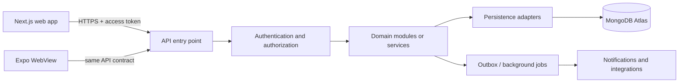

# PhysiqueQuest Database and Backend Rules

This document is the source of truth for persistence and data-service decisions. It applies to the web app, Expo WebView host, backend APIs, background workers, and any future microservices, regardless of implementation language.

## 1. Current State and Target

- The product is currently a static/local prototype. There is no running backend API, Atlas cluster, remote authentication, or cross-device synchronization.
- The frontend is a Next.js app; the Expo app hosts it in a WebView. The `backend/` folder is reserved for future server work.
- Current browser-local persistence includes simulated auth/profile data, food logs and water, Me settings, and quest progress. Exercise lists, food catalog entries, workout results, progress/notifications, and several other values are sample or in-memory data.
- MongoDB Atlas is the selected target database, but it is not provisioned or connected yet. Do not write code or documentation that presents it as live until a real, reviewed environment and connection exist.
- When persistence work begins, keep the initial backend a modular monolith unless deployment, load, ownership, or team boundaries justify a separate service. Establish domain boundaries now so a domain can later be extracted without making every feature a microservice prematurely.
- The web and mobile clients communicate with an authenticated HTTPS API. They never connect directly to Atlas.

## 2. Data Flow



Rules:

- Validate identity, authorization, input, and domain rules in the backend before reading or writing data.
- Keep database credentials, service credentials, signing keys, and privileged operations on the server. Never bundle them into Next.js client code, Expo configuration, public environment variables, or browser storage.
- Keep UI components independent of MongoDB and database-driver types. The client calls API contracts; domain services call repositories/adapters; only persistence adapters know the database driver.
- Derive the authenticated user ID from the validated server-side identity, not from a client-supplied `userId` field.
- Return only fields the caller is allowed to see. Do not expose MongoDB documents or internal errors as API responses.

### Registration and calibration data flow

The flow below records the current prototype behavior. It is deliberately separate from the target backend flow: the current UI does not call an API or MongoDB Atlas.

```mermaid
sequenceDiagram
  actor User
  participant Form as Register form (AuthForm)
  participant Page as Register page
  participant Wizard as CalibrationFlow (React state)
  participant Storage as Browser localStorage
  participant Auth as Simulated login utility
  participant Home as Home route
  User->>Form: Enter name, email, password, confirmation, consent
  Form->>Form: Check password length >= 8 and confirmation matches
  Form->>Page: Create account callback
  Page->>Page: Require name, email, consent
  Page->>Wizard: Open step 1; pass name and email
  User->>Wizard: Complete steps 1–4
  Wizard->>Wizard: Validate each step; keep fields in React state
  Wizard->>Page: Submit complete Profile
  Page->>Storage: Save physiquequest-profile JSON
  Page->>Auth: login(email, prototype-registration)
  Auth->>Storage: Read profile; write physiquequest-auth JSON
  Page->>Home: Navigate to /home
```

Current registration rules and observed behavior:

- Step 0 is the register form: it collects name and email, requires the consent checkbox, and checks that the password has at least eight characters and matches its confirmation. The register page does not receive either password value; no credential is created, stored, hashed, or sent to a server in this prototype.
- Steps 1–4 collect personal data (age, height, weight/unit, gender, optional measurements, activity), goal (including optional target weight/date and seriousness), training preferences (equipment, days, duration, phone-placement confirmation), then safety details (conditions, optional health notes, required emergency contact name and phone).
- Step values live only in the wizard's React state until step 4 succeeds. Navigating between steps preserves them; refresh, tab closure, or browser failure before completion loses them. There is no saved draft or resume flow.
- Completion builds one `Profile` object, then the register page writes it to `physiquequest-profile`. The simulated `login()` reads that profile and writes a user-shaped object to `physiquequest-auth`; the user is then routed to `/home`. These are browser-local prototype writes, not a server transaction and not Atlas persistence.
- The profile currently contains name, email, calibration and plan fields, health conditions/notes, and emergency contact details. The consent choice is required to proceed but is not included in the profile or recorded elsewhere. Camera-based analysis and emergency-alert services are not connected by this flow.
- Browser localStorage is readable by same-origin JavaScript and is not a suitable production store for passwords, session secrets, or unprotected health/emergency-contact data. Treat current values as prototype data; do not load real sensitive data into this implementation.

Target backend flow when remote registration is implemented:

1. The client submits registration data over HTTPS to an identity endpoint (or approved identity provider). Validate and normalize inputs server-side, enforce rate limits, and create a pending identity using the provider's credential handling. Never send a plaintext password to profile/calibration services or persist it in application collections/logs.
2. Return a short-lived, limited onboarding session/token. The user can complete calibration without granting access to unrelated account data. If draft recovery is a product requirement, save only validated draft updates to a dedicated onboarding draft with owner, expiry, and version; otherwise keep steps client-side until final submission.
3. On step 4, submit the complete onboarding payload once to an authenticated API. The server derives the user ID from the session, validates every field and allowed choice, normalizes units and dates, records the applicable consent evidence/version, and applies health-data access rules.
4. Persist the profile and training preferences through their domain repositories. Keep health restrictions/notes and emergency contacts separately protected when their distinct access, retention, or deletion rules warrant it. Use an idempotency key so retries cannot create duplicate onboarding records.
5. Only mark onboarding complete and activate the pending account after profile persistence succeeds. Return a minimal profile summary and route the client to the home screen. If persistence fails, retain/recover the safe client draft and allow retry; do not pretend setup completed or silently write a second local source of truth.

Do not implement this future flow until the backend, identity provider, consent language/version, data retention, and access controls are explicitly configured and reviewed. Atlas remains unconnected today.

## 3. What Needs Persistence

Use this as the initial migration map. Persist only when the feature needs accounts, durable history, multiple devices, collaboration, or server-side processing. Keep prototype fixtures clearly identified and out of production user collections.

| Domain | Current prototype source | Future persistence boundary | Guidance |
|:--|:--|:--|:--|
| Identity and sessions | Simulated `physiquequest-auth` localStorage | Authentication provider/service and user identity records | Prefer a proven identity provider. If credentials are owned by PhysiqueQuest, store only strong password hashes in a restricted auth domain; never store or log plaintext passwords. Use revocable, expiring sessions/tokens. |
| Profile and onboarding | Register wizard state until completion; then `physiquequest-profile` localStorage; simulated user in `physiquequest-auth` | Identity provider plus profile/onboarding domain APIs and repositories | Current profile includes personal, body measurement, training, health-condition/note, and emergency-contact fields. Current consent is only a required UI gate and is not recorded. For remote storage, minimize fields, record consent evidence/version, and isolate or tightly restrict health and emergency-contact data. Never store passwords in profile/auth application documents. |
| Nutrition and hydration | `physiquequest-food-log` localStorage; sample catalog and meals | User-owned meal entries and daily water records; optional managed food catalog | Preserve entry time, meal type, nutrition snapshot, quantity/unit, and source. Snapshot values used at log time so later catalog edits do not rewrite history. |
| Workout plan and sessions | Exercise fixtures, coach state, demo form scores | Workout plans and completed sessions | Store planned prescription separately from actual sets/reps/load and session outcomes. Mark demo or estimated metrics as such. |
| Progress and personal records | Sample charts and local/profile state | User measurements and verified record events | Store source and measurement time. Prefer deriving charts/rollups from authoritative events; cache aggregates only when measured performance requires it. |
| Quests, streaks, and rewards | `physiquequest-quests` localStorage and sample missions | User quest progress/reward ledger | Make point awards and mission completion idempotent. Keep an auditable award/reversal record instead of silently editing balances. |
| Settings and preferences | `physiquequest-me-settings` localStorage | User settings/preferences | Persist only cross-device or server-required settings. Keep presentation-only state local. |
| Notifications | Sample notifications and local settings | Notification preferences and user notification records | Store delivery state only when needed. Do not treat generated sample notices as real events. |
| Exercise/food reference catalog | Static TypeScript fixtures | Seeded or managed reference data only if updates, search, moderation, or scale require it | Static, version-controlled fixtures are appropriate for the current prototype. Avoid adding a database just to copy constants. |
| Camera/video and form analysis | Local device input and demo analysis | Consent-aware metadata/results; media in protected object storage only if required | Do not store raw video in MongoDB by default. Define purpose, consent, access, retention, deletion, and storage location before upload is implemented. |

Do not persist derived data twice without a clear reason. For example, calorie totals can be calculated from meal entries; a cached daily summary must have an invalidation/rebuild strategy and must not become a second source of truth.

## 4. MongoDB Data Modeling Essentials

- MongoDB is document-oriented, but every domain still needs an explicit schema, validation, ownership rules, and migration/version plan. “Schema-less” is not permission for unstructured data.
- Model around real query and update patterns. Write down the screen/API reads and writes before choosing collections or indexes.
- Embed small, bounded data that is normally read and changed with its parent and shares its lifecycle. Reference independently owned, large, unbounded, frequently changing, or separately permissioned records.
- Do not grow a user's document with an unlimited history array. Keep meals, sessions, measurements, notifications, and other growing histories in their own documents/collections, with an owner key and queryable timestamps.
- Avoid duplicating mutable profile/catalog data across documents. Immutable snapshots that preserve historical meaning (such as the nutrition values used for a logged meal) are intentional denormalization.
- Keep documents comfortably within MongoDB's 16 MiB document limit. Store images/video in managed object storage; persist a protected object key and relevant metadata only.
- Use a consistent identifier strategy. Use Atlas/MongoDB ObjectIds internally unless an externally stable ID is needed; never expose an assumption that all IDs are numbers. Validate incoming ID formats at API boundaries.
- Include UTC creation/update timestamps where useful (`createdAt`, `updatedAt`). Store event occurrence time separately (`occurredAt`/`loggedAt`) and never confuse it with database write time.
- Store units and quantities explicitly. Use a canonical unit internally and make conversions deliberate; do not persist ambiguous values such as `weight: 70` without a unit.
- Keep embedded field names stable and use schema versions or explicit migrations for breaking changes. Backfills must be resumable and safe to rerun.

### Embed or reference

Ask these questions in order:

1. Is the child bounded and small?
2. Is it normally loaded with its parent?
3. Does it have the same access control and retention lifecycle?
4. Is it updated as one logical unit?

If all are true, embedding may be a good fit. If history grows without bound, the child has its own lifecycle/permissions, or the records are queried independently, use a separate collection and reference. Avoid cross-domain document joins as the normal service integration mechanism.

## 5. Collections and Domain Ownership

Start with collections that match the first supported use cases, not a generic collection per screen. Names below are examples, not a command to create all of them immediately.

| Domain owner | Candidate records |
|:--|:--|
| Identity | `users`, `sessions` (or records owned by the identity provider) |
| Profile | `profiles`, protected health/profile records as justified |
| Nutrition | `mealEntries`, `waterLogs`, optionally `foodCatalog` |
| Training | `workoutPlans`, `workoutSessions`, exercise catalog when it becomes managed |
| Progress | `measurements`, `personalRecords` |
| Engagement | `questProgress`, `pointEvents`, `notifications`, preferences |
| Platform | `outboxEvents`, idempotency records, migration metadata when required |

- Every user-owned document must have an explicit owner key and every read/update/delete must enforce ownership in the same query or authorization path. Index owner-plus-query fields used by that domain.
- A domain owns its writes and business rules. Other domains must use a documented API/event contract instead of directly modifying its collections.
- If microservices are introduced, each service owns its data model and writes. A shared Atlas cluster may host separate databases/collections for cost or operational simplicity, but services must not depend on another service's collection schema or write to it directly.
- Do not create one database per feature automatically. Choose logical isolation, credentials, and deployment boundaries according to sensitivity, operations, and independent scaling needs.
- Cross-domain references should use stable IDs and API/event contracts. Avoid runtime coupling that requires synchronous multi-collection joins across services for ordinary screen reads.

## 6. API and Service Contracts

- Define language-neutral request/response schemas and event contracts. Include field types, required/optional status, units, validation limits, error codes, authorization scope, and versioning expectations.
- Validate and normalize all external input at the boundary. Reject unknown or invalid values deliberately; do not trust TypeScript types, UI validation, or MongoDB casts as security controls.
- Use explicit DTOs rather than returning persistence documents. Strip internal fields and protect fields such as email, health data, emergency contacts, and moderation/audit metadata.
- Use consistent error semantics: validation errors, unauthenticated, forbidden, not found, conflict, rate limited, and unexpected server failure. Do not reveal secrets, queries, stack traces, or whether a sensitive account exists unnecessarily.
- Make retryable writes safe with idempotency keys or naturally idempotent commands. This is required for meal/session submission, reward grants, payment-like actions if ever added, and message/event consumers.
- Use pagination for histories. Prefer cursor pagination on stable indexed fields (for example `occurredAt` plus `_id`) over unbounded responses or large offset scans. Set practical page-size limits.
- Version contracts deliberately. Add fields compatibly before requiring them; coordinate breaking changes and migrations across web, mobile, API, and service consumers.
- For asynchronous cross-service work, publish durable events through an outbox or equivalent transactional handoff. Consumers must be idempotent. Do not assume message delivery occurs exactly once or in order unless the infrastructure guarantees it.
- Keep API calls bounded by timeouts, rate limits, and payload limits. Never allow arbitrary client query operators, raw aggregation pipelines, or unfiltered database filters through an API.

## 7. Indexes, Queries, and Performance

- Create indexes for observed query patterns: ownership plus sort/filter keys, unique business identifiers, and fields used for authorization lookups.
- Add unique indexes for true uniqueness requirements (such as normalized account email where product rules require it); application-side “check then insert” alone is race-prone.
- Design compound index field order from equality filters, sort order, and range filters. Confirm important production queries with MongoDB explain/query-plan tools.
- Do not index every field. Indexes consume storage and slow writes; document why each nontrivial index exists and remove unused indexes safely.
- Project only fields needed by the caller, bound result size, and avoid N+1 request patterns. Do not load an entire history to calculate one screen summary.
- Prefer atomic single-document updates for local invariants. Use multi-document transactions only when a business invariant genuinely spans documents and the chosen Atlas deployment supports the required transaction behavior.
- Avoid relying on transactions to hide a data model that has unnecessary cross-document coupling. For workflows spanning services, use explicit state transitions, durable events, retries, and compensation where appropriate.

## 8. Consistency, Concurrency, and Deletion

- Declare the source of truth for each value and each state transition. Define who may create, update, reverse, and delete it.
- Use optimistic concurrency/version fields when a stale client could overwrite newer data. Return a conflict that the client can resolve rather than silently losing updates.
- Choose read/write concerns and consistency expectations based on the feature; do not promise immediate cross-region consistency or exactly-once processing without implementation support.
- Make background jobs and event consumers safe to retry. Record processing state, deduplicate by stable event/operation ID, and bound retry/backoff/dead-letter behavior.
- Define soft delete versus hard delete per data type. Soft deletion is not a substitute for a retention policy. Account deletion must include a documented process for personal records, derived data, backups, third-party copies, and legally required retention.
- Use TTL indexes only for data with an explicit expiry policy. TTL deletion is asynchronous and must not be used as an exact-time workflow or for records that need a guaranteed audit trail.
- Keep a minimal audit trail for sensitive or consequential changes (who/what/when and operation ID), while avoiding copies of unnecessary health details or secrets in logs.

## 9. Security, Privacy, and Atlas Operations

- Treat profile, body measurements, health conditions, emergency contacts, workout records, and meal history as personal data. Apply data minimization, clear purpose, explicit consent where needed, least-privilege access, and a retention/deletion policy before remote storage.
- Use Atlas private networking/private endpoints where available in the deployment environment. Do not leave broad network access enabled in production. Restrict development access and rotate credentials.
- Use separate Atlas projects/clusters or appropriately isolated databases and credentials for development, staging, and production. Never point local development at production by default.
- Give each service a dedicated database identity with only the required database/collection actions. Do not use an Atlas owner/admin credential in an application.
- Require TLS for connections and API traffic. Store secrets in the deployment secret manager/environment; keep `.env` files out of version control and provide only a placeholder `.env.example`.
- Configure automated backups, restore testing, availability, regional placement, and alerting before production launch. Define recovery point and recovery time objectives with the product owner.
- Enable audit/monitoring appropriate to the deployment and alert on connection failures, authentication anomalies, latency, storage growth, backup failures, and unusual query volume.
- Redact tokens, credentials, password material, health payloads, emergency-contact values, and raw uploaded content from application logs, traces, analytics, and crash reports.
- Threat-model every endpoint that changes profile, account, nutrition, workout, reward, or media data. Protect against broken object-level authorization, mass assignment, injection, replay, and abuse.
- Confirm applicable privacy, data-residency, and health-data obligations for actual launch jurisdictions with qualified owners; do not infer regulatory compliance from using Atlas or encryption alone.

## 10. Environments, Configuration, and Releases

- Keep the connection URI server-only (for example `MONGODB_URI`); never prefix it with `NEXT_PUBLIC_` or expose it through a WebView bridge.
- Validate required configuration at backend startup and fail closed if production secrets or required security settings are missing. Do not silently connect production to a local or development database.
- Maintain separate development, staging, and production data. Use synthetic or explicitly consented data in development; do not copy production personal records to a laptop or staging environment casually.
- Use a migration/seed tool that is versioned, reviewable, repeatable, and safe to resume. Seeds must be idempotent and environment-aware; never seed demo users into production by default.
- Deploy backward-compatible schema/API changes in stages: expand schema, deploy readers/writers, backfill, observe, then remove obsolete fields in a later release.
- Provide operational runbooks for backup restore, credential rotation, migration failure, Atlas outage, queue backlog, data deletion, and incident response before relying on production persistence.

## 11. Static-to-Database Migration Flow

When remote persistence is approved for implementation, use this order:

1. Inventory the static/localStorage data, ownership, sample status, and required user flows. Do not migrate demo fixtures as real user records.
2. Define domain ownership, data contracts, retention/consent rules, access patterns, and failure behavior.
3. Provision isolated Atlas development/staging environments and server-only secrets. Establish backup/restore and access controls before importing personal data.
4. Implement authentication/authorization and one domain API first. Add request validation, repository interfaces, persistence schemas, indexes, and safe errors.
5. Replace one localStorage owner at a time with a client API adapter. Provide loading, offline, retry, conflict, and sign-out behavior; do not silently fall back to local writes that create divergent sources of truth.
6. Migrate user data only with an explicit, validated, idempotent migration and a rollback/recovery plan. Confirm ownership and data quality; preserve sample/demo labeling.
7. Verify access controls, duplicate/retry behavior, indexes, backup restore, deletion, and cross-device behavior in staging before production rollout.
8. Remove obsolete local persistence only after remote flows are proven and a user-data export/deletion approach exists where required.

## 12. Implementation Checklist

- [ ] Is the database actually implemented in this environment, or is this still static/demo behavior?
- [ ] Does each record have an owner, source of truth, purpose, timestamp, units, and retention/deletion rule?
- [ ] Are sample/demo records separated from real user data?
- [ ] Are domain boundaries and read/write ownership clear, including if services are split later?
- [ ] Are inputs validated, outputs minimized, and object-level authorization enforced on the server?
- [ ] Are schemas/version changes and migrations safe, repeatable, and backward-compatible?
- [ ] Do indexes match bounded, paginated access patterns and uniqueness requirements?
- [ ] Are retries, duplicate requests, concurrent updates, and partial failures handled?
- [ ] Are Atlas credentials private, least-privilege, environment-specific, and rotated?
- [ ] Are backup/restore, monitoring, deletion, and incident procedures defined for the environment?
- [ ] Is raw media kept out of MongoDB unless a documented requirement justifies it?
- [ ] Do client-facing messages accurately describe offline, demo, sample, and synchronization behavior?
