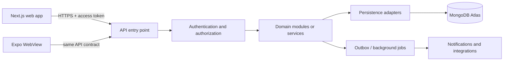

# PhysiqueQuest Database and Backend Rules

This document is the source of truth for persistence and data-service decisions. It applies to the web app, Expo WebView host, backend APIs, background workers, and any future microservices, regardless of implementation language.

## 1. Current State and Target

- **Status:** Backend API is implemented and connected to MongoDB Atlas (production database).
- The frontend is a Next.js app; the Expo app hosts it in a WebView. The `backend/` folder contains the operational NestJS API server.
- **Database:** MongoDB Atlas cluster is provisioned and operational at `pq.kbfjuql.mongodb.net` with database name `PhysiqueQuest`.
- **Authentication:** JWT-based authentication is implemented with bcrypt password hashing. Users and profiles are persisted to MongoDB Atlas.
- **Collections Active:** `users` (authentication), `profiles` (user profile data)
- The web and mobile clients communicate with an authenticated HTTPS API running on `http://localhost:4000/api` (development). They never connect directly to Atlas.
- Registration flow creates user accounts in MongoDB Atlas after completing the full calibration process. Login authenticates against stored credentials.
- Other features (workout tracking, nutrition logs, quest progress) still use localStorage and sample data. They will be migrated to the backend in future iterations following the patterns established for authentication and profiles.

## 2. Data Flow



Rules:

- Validate identity, authorization, input, and domain rules in the backend before reading or writing data.
- Keep database credentials, service credentials, signing keys, and privileged operations on the server. Never bundle them into Next.js client code, Expo configuration, public environment variables, or browser storage.
- Keep UI components independent of MongoDB and database-driver types. The client calls API contracts; domain services call repositories/adapters; only persistence adapters know the database driver.
- Derive the authenticated user ID from the validated server-side identity, not from a client-supplied `userId` field.
- Return only fields the caller is allowed to see. Do not expose MongoDB documents or internal errors as API responses.

### Registration and calibration data flow

The flow below represents the **current implemented behavior** with MongoDB Atlas backend integration.

```mermaid
sequenceDiagram
  actor User
  participant Form as Register form (AuthForm)
  participant Page as Register page
  participant Wizard as CalibrationFlow (React state)
  participant API as Backend API
  participant DB as MongoDB Atlas
  User->>Form: Enter name, email, password, confirmation, consent
  Form->>Form: Validate password requirements (8-15 chars, uppercase, lowercase, number)
  Form->>Page: Create account callback with password
  Page->>Page: Store credentials temporarily, start calibration
  Page->>Wizard: Open step 1; pass name and email
  User->>Wizard: Complete steps 1–4 (Personal Data, Goals, Training, Health & Safety)
  Wizard->>Wizard: Validate each step; keep fields in React state
  Wizard->>Page: Submit complete Profile
  Page->>API: POST /api/auth/register {name, email, password}
  API->>API: Validate password strength, hash with bcrypt
  API->>DB: Create user document in users collection
  API->>Page: Return JWT access_token + user data
  Page->>API: POST /api/profile {profile data} with JWT
  API->>API: Extract userId from JWT, validate profile DTO
  API->>DB: Create profile document in profiles collection
  API->>Page: Return profile confirmation
  Page->>localStorage: Save JWT token in physiquequest-auth
  Page->>localStorage: Save profile in physiquequest-profile (for offline)
  Page->>Home: Navigate to /home
```

Current registration rules and implemented behavior:

- **Step 0 (Auth Form):** Collects name, email, password, password confirmation, and consent checkbox.
  - Password validation enforced: 8-15 characters, at least one uppercase, one lowercase, one number
  - Real-time password strength checklist shows requirements
  - Phone number formatting applied: `0999-999-9999` format
  - Password and confirmation must match
  - All validation happens both client-side (UX) and server-side (security)

- **Steps 1–4 (Calibration):** Collects complete user profile data
  - Step 1: Personal data (age, height, weight, gender, measurements, activity)
  - Step 2: Goals (target, weight goal, date, seriousness)
  - Step 3: Training preferences (equipment, days, duration, phone placement)
  - Step 4: Health & Safety (conditions, notes, emergency contact)
  - Data stays in React state until completion
  - No server communication until final submission

- **Account Creation:** Happens ONLY after completing all 4 calibration steps
  - User account created in MongoDB Atlas `users` collection
  - Password hashed with bcrypt (10 salt rounds)
  - JWT token issued with 7-day expiration
  - Profile created in MongoDB Atlas `profiles` collection
  - Profile linked to user via `userId` reference
  - Atomic operation: if profile creation fails, user can retry without duplicate accounts

- **Data Storage:**
  - **Server (MongoDB Atlas):** Authoritative source of truth for users and profiles
  - **Client (localStorage):** JWT token for session, profile cached for offline access
  - **Security:** Passwords never stored in plain text, only bcrypt hashes in database

Current login and password-recovery behavior:

- **Login:** Fully implemented with backend authentication
  - User enters email and password
  - Frontend sends to `POST /api/auth/login`
  - Backend validates credentials against MongoDB
  - Returns JWT token on success
  - Frontend stores token and redirects to `/home`
  - Profile loaded from backend on subsequent requests

- **Password Recovery:** Still prototype/placeholder (not implemented)
  - UI shows forgot password flow but doesn't connect to backend
  - Future implementation will use email verification and secure reset tokens
  - Must implement: rate limiting, secure token generation, email delivery

Target backend flow when remote registration is implemented:

1. The client submits registration data over HTTPS to an identity endpoint (or approved identity provider). Validate and normalize inputs server-side, enforce rate limits, and create a pending identity using the provider's credential handling. Never send a plaintext password to profile/calibration services or persist it in application collections/logs.
2. Return a short-lived, limited onboarding session/token. The user can complete calibration without granting access to unrelated account data. If draft recovery is a product requirement, save only validated draft updates to a dedicated onboarding draft with owner, expiry, and version; otherwise keep steps client-side until final submission.
3. On step 4, submit the complete onboarding payload once to an authenticated API. The server derives the user ID from the session, validates every field and allowed choice, normalizes units and dates, records the applicable consent evidence/version, and applies health-data access rules.
4. Persist the profile and training preferences through their domain repositories. Keep health restrictions/notes and emergency contacts separately protected when their distinct access, retention, or deletion rules warrant it. Use an idempotency key so retries cannot create duplicate onboarding records.
5. Only mark onboarding complete and activate the pending account after profile persistence succeeds. Return a minimal profile summary and route the client to the home screen. If persistence fails, retain/recover the safe client draft and allow retry; do not pretend setup completed or silently write a second local source of truth.

Do not implement this future flow until the backend, identity provider, consent language/version, data retention, and access controls are explicitly configured and reviewed. Atlas remains unconnected today.

### Authentication and recovery flow analysis

For production, use a maintained identity provider unless there is a clear product requirement and operational capacity to own credential security. Atlas is application persistence, not a password-verification service. The Next.js and Expo clients must call an authenticated API; they must never read or write identity documents directly.

Recommended account lifecycle:

1. **Register:** validate and normalize email on the server, apply abuse controls, and create a pending identity with the selected identity provider. The provider owns password verification, password hashing, credential reset, and email verification. If first-party credentials are deliberately selected, use a separate, highly restricted credential record as described below; never store raw or reversibly encrypted passwords.
2. **Verify email:** issue a single-use, expiring challenge through the provider or a server-side notification service. Do not reveal whether an address is registered in public responses. Only a verified identity may enter the configured onboarding completion path unless product policy explicitly allows otherwise.
3. **Complete onboarding:** accept profile data using the limited onboarding session, validate and persist it through profile repositories, record consent evidence, then atomically or through a recoverable state transition mark onboarding/account active. Use an idempotency key so a retry cannot create another account/profile.
4. **Log in:** submit credentials only to the identity provider/API over TLS. Return a short-lived access credential and, if needed, a rotating refresh credential in a platform-appropriate secure cookie/storage mechanism. The API validates every protected request; client-side route guards are usability only, never authorization.
5. **Recover password:** return the same neutral acknowledgement whether or not the normalized email exists. Rate-limit requests and delivery attempts. Send a one-time link or code using an external delivery service; store only a hash of the random challenge/token (or let the provider own the challenge), bind it to user/purpose, expire it, limit attempts, and consume it atomically. Change the credential only after verification; revoke existing sessions or rotate their credentials; notify the account owner. Never store the submitted new password in reset documents or logs.
6. **Logout and account changes:** revoke the current server session/refresh-token family. Password changes, suspected compromise, and account disablement must support revoking all sessions. Account deletion must follow the deletion and retention rules in section 8.

#### Implemented MongoDB document types

These collections are currently active in MongoDB Atlas:

| Document type / collection | Implemented fields | Lifecycle and access |
|:--|:--|:--|
| `users` (authentication) | `_id` (ObjectId); `email` (string, unique, indexed, lowercase normalized); `name` (string); `passwordHash` (string, bcrypt with 10 rounds); `isActive` (boolean, default true); `createdAt` (Date); `updatedAt` (Date) | Identity domain owns writes. Email is unique and case-insensitive. Password validation enforced: 8-15 characters, 1 uppercase, 1 lowercase, 1 number. JWT tokens issued with 7-day expiration. |
| `profiles` (user profile data) | `_id` (ObjectId); `userId` (ObjectId, ref users); `name` (string); `age` (string); `height` (string); `heightInches` (string, optional); `heightUnit` ('cm' \| 'ft & in.'); `weight` (string); `weightUnit` ('kg' \| 'lbs'); `gender` ('Male' \| 'Female' \| 'Other'); `chest` (string, optional); `waist` (string, optional); `arms` (string, optional); `measurementUnit` ('cm' \| 'inch', optional); `activity` ('Sedentary' \| 'Light' \| 'Moderate' \| 'Active' \| 'Athlete'); `goal` (string, max 80 chars); `targetWeight` (string, optional); `targetDate` (date string, optional); `seriousness` (string, max 40 chars); `equipment` (array of strings); `days` (array of strings); `duration` (string, max 30 chars); `conditions` (array of strings); `healthNotes` (string, optional, max 500 chars); `contactName` (string, max 100 chars); `contactPhone` (string, formatted as 0999-999-9999, max 30 chars); `createdAt` (Date); `updatedAt` (Date) | Profile domain owns writes. Linked to user via userId reference. Created after user registration. Phone numbers formatted as Philippine mobile: 0999-999-9999. All fields validated with class-validator DTOs. Health data and emergency contacts included but require additional access controls for production. |

**Collections NOT yet implemented (future work):**
- `sessions` - Session management with refresh tokens
- `passwordCredentials` - Separate credential store (currently in users collection)
- `authChallenges` - Email verification, password reset tokens
- `consentEvidence` - Consent tracking with versions
- `authAuditEvents` - Security audit log
- `mealEntries`, `waterLogs` - Nutrition tracking
- `workoutPlans`, `workoutSessions` - Training data
- `measurements`, `personalRecords` - Progress tracking
- `questProgress`, `pointEvents` - Gamification data

#### Authentication indexes and invariants - IMPLEMENTED

Current indexes in MongoDB Atlas:

- **users collection:**
  - Unique index on `email` (case-insensitive, enforced at application level with `.toLowerCase()`)
  - Index on `_id` (default MongoDB primary key)
  
- **profiles collection:**
  - Index on `userId` (for user-to-profile lookups)
  - Index on `_id` (default MongoDB primary key)

**Future indexes needed:**
- `sessions`: Index on `userId` with revocation/expiry lookups, unique index on token hash
- `authChallenges`: Index on purpose/subject/status and expiry for bounded lookup and rate limits
- `consentEvidence`: Index on `userId` plus `capturedAt` for retrieval
- Domain-specific indexes for meal entries, workout sessions, etc. as those features are implemented

**Current implementation notes:**
- Email uniqueness enforced by unique index and duplicate-key error handling
- Concurrent registrations handled via MongoDB duplicate key error (code 11000)
- No session revocation yet (JWT tokens expire after 7 days)
- No password reset tokens or email verification challenges yet

#### Required authentication API contract behavior

- Registration and reset responses must not disclose whether an email is already registered. Validate the full payload server-side and return deliberate validation/conflict/rate-limit errors without leaking account details.
- Password confirmation is a client convenience, not a persisted field or separate API credential. Send the password only to the identity provider/auth endpoint over TLS, never to profile, analytics, logging, or onboarding-draft services.
- Never treat a browser boolean, localStorage object, profile document, or client-supplied user ID as authenticated identity. Derive owner IDs from a validated server credential on every request.
- Successful login/reset must update server-side session and credential state before returning success. The UI must not claim reset, verification, logout-all, or email delivery unless that action completed.
- Add explicit consent copy/versioning before recording evidence. Registration must not treat consent as granted if onboarding/profile persistence fails or the user withdraws it.
- Preserve an idempotency/correlation key for registration, verification, and reset mutations where retries could duplicate side effects; make email delivery and challenge consumption safe to retry.

## 3. What Needs Persistence

Use this as the initial migration map. Persist only when the feature needs accounts, durable history, multiple devices, collaboration, or server-side processing. Keep prototype fixtures clearly identified and out of production user collections.

| Domain | Current prototype source | Future persistence boundary | Guidance |
|:--|:--|:--|:--|
| Identity and sessions | Simulated `physiquequest-auth` localStorage | Provider-owned identity/session records, or app `users` plus optional restricted `passwordCredentials`, `sessions`, and `authChallenges` | Prefer a proven identity provider. Section 2 documents registration, login, recovery, logout, lifecycle fields, access controls, and index decisions. If credentials are owned by PhysiqueQuest, store only strong password hashes in a restricted auth domain; never store or log plaintext passwords. Use revocable, expiring sessions/tokens. |
| Profile and onboarding | Register wizard state until completion; then `physiquequest-profile` localStorage; simulated user in `physiquequest-auth` | Identity provider plus profile/onboarding domain APIs and repositories | Current profile includes personal, body measurement, training, health-condition/note, and emergency-contact fields. Current consent is only a required UI gate and is not recorded. For remote storage, minimize fields, record consent evidence/version, and isolate or tightly restrict health and emergency-contact data. Never store passwords in profile/auth application documents. |
| Nutrition and hydration | `physiquequest-food-log` localStorage; sample catalog and meals | User-owned meal entries and daily water records; optional managed food catalog | Preserve entry time, meal type, nutrition snapshot, quantity/unit, and source. Snapshot values used at log time so later catalog edits do not rewrite history. |
| Workout plan and sessions | Exercise fixtures, coach state, demo form scores | Workout plans and completed sessions | Store planned prescription separately from actual sets/reps/load and session outcomes. Mark demo or estimated metrics as such. |
| Progress and personal records | Sample charts and local/profile state | User measurements and verified record events | Store source and measurement time. Prefer deriving charts/rollups from authoritative events; cache aggregates only when measured performance requires it. |
| Quests, streaks, and rewards | `physiquequest-quests` localStorage and sample missions | User quest progress/reward ledger | Make point awards and mission completion idempotent. Keep an auditable award/reversal record instead of silently editing balances. |
| Settings and preferences | `physiquequest-me-settings` localStorage | User settings/preferences | Persist only cross-device or server-required settings. Keep presentation-only state local. |
| Notifications | Sample notifications and local settings | Notification preferences and user notification records | Store delivery state only when needed. Do not treat generated sample notices as real events. |
| Exercise/food reference catalog | Static TypeScript fixtures | Seeded or managed reference data only if updates, search, moderation, or scale require it | Static, version-controlled fixtures are appropriate for the current prototype. Avoid adding a database just to copy constants. |
| Camera/video and form analysis | Local device input and demo analysis | Consent-aware metadata/results; media in protected object storage only if required | Do not store raw video in MongoDB by default. Define purpose, consent, access, retention, deletion, and storage location before upload is implemented. |

Do not persist derived data twice without a clear reason. For example, calorie totals can be calculated from meal entries; a cached daily summary must have an invalidation/rebuild strategy and must not become a second source of truth.

## 4. MongoDB Data Modeling Essentials

- MongoDB is document-oriented, but every domain still needs an explicit schema, validation, ownership rules, and migration/version plan. “Schema-less” is not permission for unstructured data.
- Model around real query and update patterns. Write down the screen/API reads and writes before choosing collections or indexes.
- Embed small, bounded data that is normally read and changed with its parent and shares its lifecycle. Reference independently owned, large, unbounded, frequently changing, or separately permissioned records.
- Do not grow a user's document with an unlimited history array. Keep meals, sessions, measurements, notifications, and other growing histories in their own documents/collections, with an owner key and queryable timestamps.
- Avoid duplicating mutable profile/catalog data across documents. Immutable snapshots that preserve historical meaning (such as the nutrition values used for a logged meal) are intentional denormalization.
- Keep documents comfortably within MongoDB's 16 MiB document limit. Store images/video in managed object storage; persist a protected object key and relevant metadata only.
- Use a consistent identifier strategy. Use Atlas/MongoDB ObjectIds internally unless an externally stable ID is needed; never expose an assumption that all IDs are numbers. Validate incoming ID formats at API boundaries.
- Include UTC creation/update timestamps where useful (`createdAt`, `updatedAt`). Store event occurrence time separately (`occurredAt`/`loggedAt`) and never confuse it with database write time.
- Store units and quantities explicitly. Use a canonical unit internally and make conversions deliberate; do not persist ambiguous values such as `weight: 70` without a unit.
- Keep embedded field names stable and use schema versions or explicit migrations for breaking changes. Backfills must be resumable and safe to rerun.

### Embed or reference

Ask these questions in order:

1. Is the child bounded and small?
2. Is it normally loaded with its parent?
3. Does it have the same access control and retention lifecycle?
4. Is it updated as one logical unit?

If all are true, embedding may be a good fit. If history grows without bound, the child has its own lifecycle/permissions, or the records are queried independently, use a separate collection and reference. Avoid cross-domain document joins as the normal service integration mechanism.

## 5. Collections and Domain Ownership

Start with collections that match the first supported use cases, not a generic collection per screen. Names below are examples, not a command to create all of them immediately.

| Domain owner | Candidate records |
|:--|:--|
| Identity | `users`, `sessions` (or records owned by the identity provider) |
| Profile | `profiles`, protected health/profile records as justified |
| Nutrition | `mealEntries`, `waterLogs`, optionally `foodCatalog` |
| Training | `workoutPlans`, `workoutSessions`, exercise catalog when it becomes managed |
| Progress | `measurements`, `personalRecords` |
| Engagement | `questProgress`, `pointEvents`, `notifications`, preferences |
| Platform | `outboxEvents`, idempotency records, migration metadata when required |

- Every user-owned document must have an explicit owner key and every read/update/delete must enforce ownership in the same query or authorization path. Index owner-plus-query fields used by that domain.
- A domain owns its writes and business rules. Other domains must use a documented API/event contract instead of directly modifying its collections.
- If microservices are introduced, each service owns its data model and writes. A shared Atlas cluster may host separate databases/collections for cost or operational simplicity, but services must not depend on another service's collection schema or write to it directly.
- Do not create one database per feature automatically. Choose logical isolation, credentials, and deployment boundaries according to sensitivity, operations, and independent scaling needs.
- Cross-domain references should use stable IDs and API/event contracts. Avoid runtime coupling that requires synchronous multi-collection joins across services for ordinary screen reads.

## 6. API and Service Contracts

- Define language-neutral request/response schemas and event contracts. Include field types, required/optional status, units, validation limits, error codes, authorization scope, and versioning expectations.
- Validate and normalize all external input at the boundary. Reject unknown or invalid values deliberately; do not trust TypeScript types, UI validation, or MongoDB casts as security controls.
- Use explicit DTOs rather than returning persistence documents. Strip internal fields and protect fields such as email, health data, emergency contacts, and moderation/audit metadata.
- Use consistent error semantics: validation errors, unauthenticated, forbidden, not found, conflict, rate limited, and unexpected server failure. Do not reveal secrets, queries, stack traces, or whether a sensitive account exists unnecessarily.
- Make retryable writes safe with idempotency keys or naturally idempotent commands. This is required for meal/session submission, reward grants, payment-like actions if ever added, and message/event consumers.
- Use pagination for histories. Prefer cursor pagination on stable indexed fields (for example `occurredAt` plus `_id`) over unbounded responses or large offset scans. Set practical page-size limits.
- Version contracts deliberately. Add fields compatibly before requiring them; coordinate breaking changes and migrations across web, mobile, API, and service consumers.
- For asynchronous cross-service work, publish durable events through an outbox or equivalent transactional handoff. Consumers must be idempotent. Do not assume message delivery occurs exactly once or in order unless the infrastructure guarantees it.
- Keep API calls bounded by timeouts, rate limits, and payload limits. Never allow arbitrary client query operators, raw aggregation pipelines, or unfiltered database filters through an API.

## 7. Indexes, Queries, and Performance

- Create indexes for observed query patterns: ownership plus sort/filter keys, unique business identifiers, and fields used for authorization lookups.
- Add unique indexes for true uniqueness requirements (such as normalized account email where product rules require it); application-side “check then insert” alone is race-prone.
- Design compound index field order from equality filters, sort order, and range filters. Confirm important production queries with MongoDB explain/query-plan tools.
- Do not index every field. Indexes consume storage and slow writes; document why each nontrivial index exists and remove unused indexes safely.
- Project only fields needed by the caller, bound result size, and avoid N+1 request patterns. Do not load an entire history to calculate one screen summary.
- Prefer atomic single-document updates for local invariants. Use multi-document transactions only when a business invariant genuinely spans documents and the chosen Atlas deployment supports the required transaction behavior.
- Avoid relying on transactions to hide a data model that has unnecessary cross-document coupling. For workflows spanning services, use explicit state transitions, durable events, retries, and compensation where appropriate.

## 8. Consistency, Concurrency, and Deletion

- Declare the source of truth for each value and each state transition. Define who may create, update, reverse, and delete it.
- Use optimistic concurrency/version fields when a stale client could overwrite newer data. Return a conflict that the client can resolve rather than silently losing updates.
- Choose read/write concerns and consistency expectations based on the feature; do not promise immediate cross-region consistency or exactly-once processing without implementation support.
- Make background jobs and event consumers safe to retry. Record processing state, deduplicate by stable event/operation ID, and bound retry/backoff/dead-letter behavior.
- Define soft delete versus hard delete per data type. Soft deletion is not a substitute for a retention policy. Account deletion must include a documented process for personal records, derived data, backups, third-party copies, and legally required retention.
- Use TTL indexes only for data with an explicit expiry policy. TTL deletion is asynchronous and must not be used as an exact-time workflow or for records that need a guaranteed audit trail.
- Keep a minimal audit trail for sensitive or consequential changes (who/what/when and operation ID), while avoiding copies of unnecessary health details or secrets in logs.

## 9. Security, Privacy, and Atlas Operations

- Treat profile, body measurements, health conditions, emergency contacts, workout records, and meal history as personal data. Apply data minimization, clear purpose, explicit consent where needed, least-privilege access, and a retention/deletion policy before remote storage.
- Use Atlas private networking/private endpoints where available in the deployment environment. Do not leave broad network access enabled in production. Restrict development access and rotate credentials.
- Use separate Atlas projects/clusters or appropriately isolated databases and credentials for development, staging, and production. Never point local development at production by default.
- Give each service a dedicated database identity with only the required database/collection actions. Do not use an Atlas owner/admin credential in an application.
- Require TLS for connections and API traffic. Store secrets in the deployment secret manager/environment; keep `.env` files out of version control and provide only a placeholder `.env.example`.
- Configure automated backups, restore testing, availability, regional placement, and alerting before production launch. Define recovery point and recovery time objectives with the product owner.
- Enable audit/monitoring appropriate to the deployment and alert on connection failures, authentication anomalies, latency, storage growth, backup failures, and unusual query volume.
- Redact tokens, credentials, password material, health payloads, emergency-contact values, and raw uploaded content from application logs, traces, analytics, and crash reports.
- Threat-model every endpoint that changes profile, account, nutrition, workout, reward, or media data. Protect against broken object-level authorization, mass assignment, injection, replay, and abuse.
- Confirm applicable privacy, data-residency, and health-data obligations for actual launch jurisdictions with qualified owners; do not infer regulatory compliance from using Atlas or encryption alone.

## 10. Environments, Configuration, and Releases

- Keep the connection URI server-only (for example `MONGODB_URI`); never prefix it with `NEXT_PUBLIC_` or expose it through a WebView bridge.
- Validate required configuration at backend startup and fail closed if production secrets or required security settings are missing. Do not silently connect production to a local or development database.
- Maintain separate development, staging, and production data. Use synthetic or explicitly consented data in development; do not copy production personal records to a laptop or staging environment casually.
- Use a migration/seed tool that is versioned, reviewable, repeatable, and safe to resume. Seeds must be idempotent and environment-aware; never seed demo users into production by default.
- Deploy backward-compatible schema/API changes in stages: expand schema, deploy readers/writers, backfill, observe, then remove obsolete fields in a later release.
- Provide operational runbooks for backup restore, credential rotation, migration failure, Atlas outage, queue backlog, data deletion, and incident response before relying on production persistence.

## 11. Static-to-Database Migration Flow

When remote persistence is approved for implementation, use this order:

1. Inventory the static/localStorage data, ownership, sample status, and required user flows. Do not migrate demo fixtures as real user records.
2. Define domain ownership, data contracts, retention/consent rules, access patterns, and failure behavior.
3. Provision isolated Atlas development/staging environments and server-only secrets. Establish backup/restore and access controls before importing personal data.
4. Implement authentication/authorization and one domain API first. Add request validation, repository interfaces, persistence schemas, indexes, and safe errors.
5. Replace one localStorage owner at a time with a client API adapter. Provide loading, offline, retry, conflict, and sign-out behavior; do not silently fall back to local writes that create divergent sources of truth.
6. Migrate user data only with an explicit, validated, idempotent migration and a rollback/recovery plan. Confirm ownership and data quality; preserve sample/demo labeling.
7. Verify access controls, duplicate/retry behavior, indexes, backup restore, deletion, and cross-device behavior in staging before production rollout.
8. Remove obsolete local persistence only after remote flows are proven and a user-data export/deletion approach exists where required.

## 12. Implementation Checklist

- [x] Is the database actually implemented in this environment, or is this still static/demo behavior?
  - **MongoDB Atlas is connected and operational with users and profiles collections**
- [x] Does each record have an owner, source of truth, purpose, timestamp, units, and retention/deletion rule?
  - **Users and profiles have explicit ownership, timestamps, and units specified**
- [x] Are sample/demo records separated from real user data?
  - **Real user data stored in Atlas, sample data remains in frontend fixtures**
- [x] Are domain boundaries and read/write ownership clear, including if services are split later?
  - **Identity (users) and Profile domains clearly separated with proper references**
- [x] Are inputs validated, outputs minimized, and object-level authorization enforced on the server?
  - **class-validator DTOs for all inputs, JWT guards on protected endpoints**
- [ ] Are schemas/version changes and migrations safe, repeatable, and backward-compatible?
  - **Initial schema v1.0, no migrations yet - to be addressed in future versions**
- [x] Do indexes match bounded, paginated access patterns and uniqueness requirements?
  - **Unique email index, userId reference index implemented**
- [ ] Are retries, duplicate requests, concurrent updates, and partial failures handled?
  - **Duplicate email handled, concurrent profile updates need optimistic locking**
- [x] Are Atlas credentials private, least-privilege, environment-specific, and rotated?
  - **Credentials in .env file, not in version control, .env.example provided**
- [ ] Are backup/restore, monitoring, deletion, and incident procedures defined for the environment?
  - **Atlas automated backups enabled, monitoring and procedures to be documented**
- [x] Is raw media kept out of MongoDB unless a documented requirement justifies it?
  - **No media storage in MongoDB, only metadata if needed**
- [x] Do client-facing messages accurately describe offline, demo, sample, and synchronization behavior?
  - **Clear error messages, localStorage used only for caching JWT and profile**

## 13. Measurement units in profile data

Personal-data measurements are user-entered values and their unit is part of the data contract. The current registration wizard stores its completed profile in browser localStorage; Atlas remains unconnected. Do not treat these local fields as canonical metric values or omit their unit when moving data between the UI, local profile, API, or future persistence.

Current profile fields:

| Field(s) | Meaning |
|:--|:--|
| `height`, `heightUnit`, `heightInches` | `height` is the entered centimeters when `heightUnit` is `cm`; for `ft & in.`, `height` is feet and `heightInches` is the inches component. |
| `weight`, `weightUnit` | Entered body weight and its selected `kg` or `lbs` unit. |
| `targetWeight`, `weightUnit` | Target weight uses the same selected weight unit as body weight; changing that selection converts both values. |
| `chest`, `waist`, `arms`, `measurementUnit` | Entered body measurements and their shared `cm` or `inch` unit. |

BMI calculations normalize height to meters and weight to kilograms in memory. Preserve the user's selected raw values and explicit units in the profile. Future APIs and persistence schemas must validate allowed unit codes and either retain value-plus-unit pairs or convert to an explicitly named canonical field while also preserving the user's display unit where required. Never infer units from locale, a numeric range, or a default after the fact. A unit change in the UI must convert the displayed value or require the user to re-enter it before saving; it must never silently change the measurement's meaning.

No database migration is applicable to the current implementation because there is no live database. If a future stored profile collection exists without explicit unit fields, its migration must identify legacy defaults from the versioned product behavior, label uncertain records for remediation, and be reviewed before deployment; do not fabricate unit certainty.
