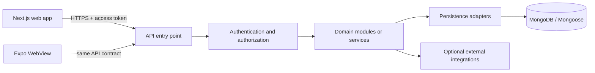

# PhysiqueQuest Database and Backend Rules

This document is the source of truth for persistence and data-service decisions. It applies to the web app, Expo WebView host, backend APIs, background workers, and any future microservices, regardless of implementation language.

**Mandatory governing rules:** Follow [GENERAL.md](./GENERAL.md) together with this backend and persistence guide. [DESIGN.md](./DESIGN.md) governs frontend design; [PROCEDURES.md](./PROCEDURES.md) governs architecture and engineering workflow.

## 1. Current State

- **Status:** The repository contains an implemented NestJS API and Mongoose persistence layer. Whether Atlas is reachable, which environment is configured, and whether that environment is production cannot be established from source alone.
- The frontend is a Next.js app; the Expo app hosts it in a WebView. The `backend/` folder contains the operational NestJS API server.
- **Database:** MongoDB/Mongoose is configured by the backend using server-side environment settings. Do not record connection strings, cluster hosts, credentials, or claims about deployed environments in these rules.
- **Authentication:** JWT-based authentication and bcrypt password hashing are implemented. Backend models define user and profile persistence; environment connectivity must be verified at runtime.
- **Defined collections:** The backend defines models for `users`, `profiles`, `nutrition`, `workout_sessions`, `progress_entries`, `settings`, `activity`, `notifications`, `safety_alert_events`, `password_recovery_tokens`, and exercise catalogs. Model definitions do not prove that a remote deployment is currently reachable.
- The web client and Expo WebView communicate with the NestJS API using the `/api` prefix. Development uses port 4000 by default; the mobile client derives the host from the web app's LAN address. Clients never connect directly to MongoDB.
- The backend registration handler creates user documents after the full calibration process. Login authenticates against stored credentials; configured database connectivity is environment-dependent.
- Profiles, meals, water, workouts, progress, quests/streaks, notifications, settings, and exercise data use backend API/model implementations. The JWT, profile response cache, recent-food suggestions, and optional API URL override remain client-side; they are not authoritative copies of backend records.
- Food-photo analysis is handled by the authenticated backend's Gemini/USDA integrations. The user reviews the estimate before saving matched items as meals. The separately managed `food-scanner/` directory is not a backend runtime dependency.

## 2. Data Flow



Rules:

- Validate identity, authorization, input, and domain rules in the backend before reading or writing data.
- Keep database credentials, service credentials, signing keys, and privileged operations on the server. Never bundle them into Next.js client code, Expo configuration, public environment variables, or browser storage.
- Keep UI components independent of MongoDB and database-driver types. The client calls API contracts; domain services call repositories/adapters; only persistence adapters know the database driver.
- Derive the authenticated user ID from the validated server-side identity, not from a client-supplied `userId` field.
- Return only fields the caller is allowed to see. Do not expose MongoDB documents or internal errors as API responses.

### Registration and calibration data flow

The flow below represents the **current implemented API behavior**; runtime database connectivity is environment-dependent.

```mermaid
sequenceDiagram
  actor User
  participant Form as Register form (AuthForm)
  participant Page as Register page
  participant Wizard as CalibrationFlow (React state)
  participant API as Backend API
  participant DB as MongoDB/Mongoose
  User->>Form: Enter name, email, password, confirmation, consent
  Form->>Form: Validate password requirements (8-15 chars, uppercase, lowercase, number)
  Form->>Page: Create account callback with password
  Page->>Page: Store credentials temporarily, start calibration
  Page->>Wizard: Open step 1; pass name and email
  User->>Wizard: Complete steps 1–4 (Personal Data, Goals, Training, Health & Safety)
  Wizard->>Wizard: Validate each step; keep fields in React state
  Wizard->>Page: Submit complete Profile
  Page->>API: POST /api/auth/register {name, email, password}
  API->>API: Validate password strength, hash with bcrypt
  API->>DB: Create user document in users collection
  API->>Page: Return JWT access_token + user data
  Page->>API: POST /api/profile {profile data} with JWT
  API->>API: Extract userId from JWT, validate profile DTO
  API->>DB: Create profile document in profiles collection
  API->>Page: Return profile confirmation
  Page->>localStorage: Save JWT token in physiquequest-auth
  Page->>localStorage: Cache profile in physiquequest-profile (not authoritative or offline mode)
  Page->>Home: Navigate to /home
```

Current registration rules and implemented behavior:

- **Step 0 (Auth Form):** Collects name, email, password, password confirmation, and consent checkbox.
  - Password validation enforced: 8-15 characters, at least one uppercase, one lowercase, one number
  - Real-time password strength checklist shows requirements
  - Phone number formatting applied: `0999-999-9999` format
  - Password and confirmation must match
  - All validation happens both client-side (UX) and server-side (security)

- **Steps 1–4 (Calibration):** Collects complete user profile data
  - Step 1: Personal data (age, height, weight, gender, measurements, activity)
  - Step 2: Goals (target, weight goal, date, seriousness)
  - Step 3: Training preferences (equipment, days, duration, phone placement)
  - Step 4: Health & Safety (conditions, notes, emergency contact)
  - Data stays in React state until completion
  - No server communication until final submission

- **Account Creation:** Happens ONLY after completing all 4 calibration steps
  - User account created in MongoDB Atlas `users` collection
  - Password hashed with bcrypt (10 salt rounds)
  - JWT token issued with 7-day expiration
  - Profile created in MongoDB Atlas `profiles` collection
  - Profile linked to user via `userId` reference
  - User and profile writes are currently two sequential API operations, not one database transaction. If profile creation fails after account creation, the account remains and recovery should use login plus a profile-retry path; do not describe registration as atomic.

- **Data Storage:**
  - **Server (MongoDB Atlas):** Authoritative source of truth for users and profiles
  - **Client (localStorage):** JWT token and a cached profile copy; profile routes fetch the backend and are not an offline mode
  - **Security:** Passwords never stored in plain text, only bcrypt hashes in database

Current login and password-recovery behavior:

- **Login:** Fully implemented with backend authentication
  - User enters email and password
  - Frontend sends to `POST /api/auth/login`
  - Backend validates credentials against MongoDB
  - Returns JWT token on success
  - Frontend stores token and redirects to `/home`
  - Profile loaded from backend on subsequent requests

- **Password Recovery:** Fully implemented
  - `POST /api/auth/password-reset/request` and `POST /api/auth/password-reset/confirm`
  - `password_recovery_tokens` collection stores SHA-256 hashes of one-time tokens (never plaintext), with expiry and one-time use
  - Delivery is via an external `EMAIL_DELIVERY_URL` endpoint; when unconfigured, `request` returns `{ accepted: true, delivery: "unavailable" }` without error
  - Responses are neutral about whether an email is registered

Target backend flow when remote registration is implemented:

1. The client submits registration data over HTTPS to an identity endpoint (or approved identity provider). Validate and normalize inputs server-side, enforce rate limits, and create a pending identity using the provider's credential handling. Never send a plaintext password to profile/calibration services or persist it in application collections/logs.
2. Return a short-lived, limited onboarding session/token. The user can complete calibration without granting access to unrelated account data. If draft recovery is a product requirement, save only validated draft updates to a dedicated onboarding draft with owner, expiry, and version; otherwise keep steps client-side until final submission.
3. On step 4, submit the complete onboarding payload once to an authenticated API. The server derives the user ID from the session, validates every field and allowed choice, normalizes units and dates, records the applicable consent evidence/version, and applies health-data access rules.
4. Persist the profile and training preferences through their domain repositories. Keep health restrictions/notes and emergency contacts separately protected when their distinct access, retention, or deletion rules warrant it. Use an idempotency key so retries cannot create duplicate onboarding records.
5. Only mark onboarding complete and activate the pending account after profile persistence succeeds. Return a minimal profile summary and route the client to the home screen. If persistence fails, retain/recover the safe client draft and allow retry; do not pretend setup completed or silently write a second local source of truth.

The repository implements the first-party JWT API and MongoDB/Mongoose integration for nutrition, workouts, progress, quests, notifications, and settings. Runtime database connectivity is environment-dependent. Remaining production hardening includes email verification, onboarding idempotency, and recorded consent evidence. Password reset request/verify/confirm flows are implemented; configure both `EMAIL_DELIVERY_URL` and `EMAIL_DELIVERY_API_KEY` in deployed environments. The no-email code response is development-only.

### Authentication and recovery flow analysis

For production, use a maintained identity provider unless there is a clear product requirement and operational capacity to own credential security. Atlas is application persistence, not a password-verification service. The Next.js and Expo clients must call an authenticated API; they must never read or write identity documents directly.

Recommended account lifecycle:

1. **Register:** validate and normalize email on the server, apply abuse controls, and create a pending identity with the selected identity provider. The provider owns password verification, password hashing, credential reset, and email verification. If first-party credentials are deliberately selected, use a separate, highly restricted credential record as described below; never store raw or reversibly encrypted passwords.
2. **Verify email:** issue a single-use, expiring challenge through the provider or a server-side notification service. Do not reveal whether an address is registered in public responses. Only a verified identity may enter the configured onboarding completion path unless product policy explicitly allows otherwise.
3. **Complete onboarding:** accept profile data using the limited onboarding session, validate and persist it through profile repositories, record consent evidence, then atomically or through a recoverable state transition mark onboarding/account active. Use an idempotency key so a retry cannot create another account/profile.
4. **Log in:** submit credentials only to the identity provider/API over TLS. Return a short-lived access credential and, if needed, a rotating refresh credential in a platform-appropriate secure cookie/storage mechanism. The API validates every protected request; client-side route guards are usability only, never authorization.
5. **Recover password:** return the same neutral acknowledgement whether or not the normalized email exists. Rate-limit requests and delivery attempts. Send a one-time link or code using an external delivery service; store only a hash of the random challenge/token (or let the provider own the challenge), bind it to user/purpose, expire it, limit attempts, and consume it atomically. Change the credential only after verification; revoke existing sessions or rotate their credentials; notify the account owner. Never store the submitted new password in reset documents or logs.
6. **Logout and account changes:** revoke the current server session/refresh-token family. Password changes, suspected compromise, and account disablement must support revoking all sessions. Account deletion must follow the deletion and retention rules in section 8.

#### Implemented MongoDB document types

These collections are currently active in MongoDB Atlas:

| Document type / collection | Implemented fields | Lifecycle and access |
|:--|:--|:--|
| `users` (authentication) | `_id` (ObjectId); `email` (string, unique, lowercase, trimmed); `name` (string); `passwordHash` (string, bcrypt with 10 rounds, `select: false`); `isActive` (boolean, default true); `role` (`user` \| `admin`, default `user`); `failedLoginAttempts` (number, default 0); `lockoutUntil` (Date \| null, default null); `createdAt` (Date); `updatedAt` (Date) | Identity domain owns writes. Email is unique. Password validation enforced: 8-15 characters, 1 uppercase, 1 lowercase, 1 number. JWT tokens issued with `JWT_EXPIRES_IN` (default `7d`). Five failed logins set `lockoutUntil` 15 minutes ahead (`auth.service.ts`). |
| `profiles` (user profile data) | `_id` (ObjectId); `userId` (ObjectId, ref users, unique); `name` (string, required); `age`, `height`, `weight` (strings, required); `heightInches` (string, optional); `heightUnit` (`cm` \| `ft & in.`); `weightUnit` (`kg` \| `lbs`); `gender` (string, required); `chest`, `waist`, `arms` (strings, optional) with `chestUnit`, `waistUnit`, `armsUnit` (`cm` \| `inch`, optional); `measurementUnit` (`cm` \| `inch`, optional legacy shared unit); `activity` (string, required); `goal` (string, required); `targetWeight`, `targetDate` (strings, optional); `seriousness` (string, required); `equipment`, `days` (string arrays, required); `duration` (string, required); `conditions` (string array, default `[]`); `healthNotes` (string, default `''`); `contactName`, `contactPhone` (strings, required); `contactRelationship` (string, optional); `createdAt`, `updatedAt` (Date) | Profile domain owns writes. Linked to user via `userId` reference (unique). Created after user registration. Enum constraints exist only for unit fields in the schema; value ranges and formats (for example the `0999-999-9999` phone format and `gender`/`activity` choices) are enforced by the class-validator DTOs, not the schema. Health data and emergency contacts require additional access controls for production. |
| `nutrition` (meals + water) | `_id` (ObjectId); `userId` (ObjectId, ref users, unique); `meals: MealEntry[]` (`id`, `name`, `meal`, `calories`, `detail`, `time`, `source`, `protein`, `carbs`, `fat`, `date`); `water: WaterEntry[]` (`date`, `glasses`) | Nutrition domain owns writes. One document per user holding all meals and water entries. |
| `workout_sessions` | `_id` (ObjectId); `userId` (ObjectId, ref users, indexed, non-unique); `exerciseIds` (string array); `startedAt` (Date); `endedAt`, `pausedAt` (Date, optional); `pausedSeconds` (number, default 0); `status` (`active` \| `completed`, default `active`); `durationSeconds` (number, optional); `exerciseResults` (embedded: `exerciseId`, `reps`, `loadKg?`); `createdAt`, `updatedAt` | Training domain owns writes. Results are embedded because they are bounded per session and share its lifecycle. |
| `progress_entries` | `_id` (ObjectId); `userId` (ObjectId, ref users, indexed, non-unique); `metric` (`weight` \| `waist` \| `benchPress`); `value` (number, 0.1–1000); `unit` (`kg` \| `lb` \| `cm` \| `in`); `measuredAt` (Date, required); `createdAt`, `updatedAt` | Progress domain owns writes. `measuredAt` is the measurement time, separate from write time. |
| `settings` | `_id` (ObjectId); `userId` (ObjectId, ref users, unique); `values: Record<string, unknown>` | Settings domain owns writes. |
| `activity` | `_id` (ObjectId); `userId` (ObjectId, ref users, unique); `state: Record<string, unknown>` (quest progress, level, streak, points) | Engagement domain owns writes. |
| `notifications` | `_id` (ObjectId); `userId` (ObjectId, ref users, unique); `items` (embedded `NotificationItem[]`: `id`, `icon`, `title`, `subtitle` (default ''), `body`, `time`, `group`, `unread` (default true)) | Engagement domain owns writes. |
| `safety_alert_events` | `_id` (ObjectId); `userId` (ObjectId, ref users); `idempotencyKey`; `eventType` (`manual`); `status` (`pending` \| `delivered` \| `failed`); `errorCode`, `providerReference` (optional); `occurredAt` (Date) | Safety domain owns writes. Compound unique index on `{ userId, idempotencyKey }` makes retries safe. |
| `password_recovery_tokens` | `_id` (ObjectId); `userId` (ObjectId, ref users, indexed); `tokenHash` (unique, `select: false`, SHA-256); `expiresAt` (TTL, `expires: 0`); `usedAt` (Date \| null, default null) | Auth domain owns writes. One-time use, expiry, never stores plaintext. |
| `admin_exercises` (`exercises/schemas`) | `_id` (ObjectId); `name` (max 80); `slug`; `group`; `status` (`draft` \| `published`, default `draft`); `pose` (`missing` \| `ready` \| `training`, default `missing`); `targetMuscle`, `equipment`, `difficulty`, `pictureUrl`, `videoUrl`, `trackingStatus`; `instructions` (string array) | Admin domain owns writes. Indexes on `targetMuscle`, `equipment`, and `{ status, pose }`. |
| `exercises` (`exercise/exercise.schema.ts`, default collection name) | `_id` (ObjectId); `name` (required, unique); `targetMuscle`, `equipment`, `difficulty` (required strings); `pictureUrl`, `videoUrl` (optional); `instructions` (string array); `trackingStatus` (default `Manual`) | Read by the public exercise library. Confirm which exercise model each module writes to before adding fields; two exercise schemas coexist. |

**Collections NOT yet implemented (future work):**
- `sessions` - Session management with refresh tokens
- `passwordCredentials` - Separate credential store (currently in users collection)
- `authChallenges` - Email verification challenges
- `consentEvidence` - Consent tracking with versions
- `authAuditEvents` - Security audit log

#### Authentication indexes and invariants - IMPLEMENTED

Indexes defined or ensured by the backend:

- **users collection:** unique index on `email` (schema `lowercase: true` normalizes the value before insert).
- **profiles collection:** unique index on `userId` (one profile per user).
- **password_recovery_tokens collection:** index on `userId`, unique index on `tokenHash`, and TTL index on `expiresAt`.
- **Other user-owned collections:** `nutrition`, `settings`, `activity`, and `notifications` have unique `userId`. `workout_sessions`, `progress_entries`, and `safety_alert_events` (compound unique on `{ userId, idempotencyKey }`) are indexed by owner. `workout_sessions` and `progress_entries` `userId` indexes are non-unique.

**Future indexes needed:**
- `sessions`: Index on `userId` with revocation/expiry lookups, unique index on token hash
- `authChallenges`: Index on purpose/subject/status and expiry for bounded lookup and rate limits
- `consentEvidence`: Index on `userId` plus `capturedAt` for retrieval

**Current implementation notes:**
- Email uniqueness enforced by unique index and duplicate-key error handling
- Concurrent registrations handled via MongoDB duplicate key error (code 11000)
- No session revocation yet (JWT tokens expire after 7 days)
- Password reset is implemented: `password_recovery_tokens` has `userId` index, unique `tokenHash` (SHA-256), and a TTL `expiresAt` index.

#### Required authentication API contract behavior

- Registration and reset responses must not disclose whether an email is already registered. Validate the full payload server-side and return deliberate validation/conflict/rate-limit errors without leaking account details.
- Password confirmation is a client convenience, not a persisted field or separate API credential. Send the password only to the identity provider/auth endpoint over TLS, never to profile, analytics, logging, or onboarding-draft services.
- Never treat a browser boolean, localStorage object, profile document, or client-supplied user ID as authenticated identity. Derive owner IDs from a validated server credential on every request.
- Successful login/reset must update server-side session and credential state before returning success. The UI must not claim reset, verification, logout-all, or email delivery unless that action completed.
- Add explicit consent copy/versioning before recording evidence. Registration must not treat consent as granted if onboarding/profile persistence fails or the user withdraws it.
- Preserve an idempotency/correlation key for registration, verification, and reset mutations where retries could duplicate side effects; make email delivery and challenge consumption safe to retry.

## 3. Current Persistence Map

The following summarizes the repository's current source-of-truth boundaries. The backend implementation does not by itself prove that any remote deployment is healthy or production-ready.

| Domain | Current source of truth | Client-only state or limitations | Guidance |
|:--|:--|:--|:--|
| Identity and sessions | Backend `users` model and JWT auth; `physiquequest-auth` stores the client credential/user cache | No password is stored in the browser; JWT revocation is not implemented | Derive ownership from validated server-side JWT claims. Never treat localStorage as proof of identity. |
| Profile and onboarding | Backend `profiles` model/API | `physiquequest-profile` is a cache; registration/profile writes use API requests | Profile data includes personal, body measurement, training, health-condition/note, and emergency-contact fields. Minimize access and define consent, retention, and deletion controls before production use. |
| Nutrition and hydration | Backend nutrition API/model stores meals and water | `physiquequest-recent-foods` stores suggestions only | Scan estimates are not saved until confirmed; persist the nutrition snapshot and source with the meal entry. |
| Workouts | Backend workout API/model | Coach camera readiness/form feedback and some workout signals are prototype behavior | Distinguish persisted workout records from estimated or unverified performance signals. |
| Progress | Backend progress API/model | None of the logged records should be represented as verified measurements unless the input source establishes that | Retain unit, source, and measurement time. |
| Quests, streaks, and rewards | Backend activity API/model | The leaderboard is preview/sample data | Keep the sample leaderboard clearly labeled; do not present it as live cross-user ranking. |
| Settings and notifications | Backend settings and notifications APIs/models | Presentation-only state may remain in memory | Keep user-owned state on the API; do not create divergent local write copies. |
| Exercise and food reference data | Backend exercise APIs/models plus versioned frontend exercise fallback; authenticated food lookup and scan endpoints use the backend Gemini/USDA integrations | A static exercise fallback may appear when the API is unavailable | Mark fallback/sample data accurately; do not present it as a successful live API response. |
| Camera/video and pose analysis | Device input and optional backend pose endpoint | Camera readiness, local video handling, and unconfigured pose integrations are not verified AI analysis | Do not store raw video in MongoDB by default. Define purpose, consent, access, retention, deletion, and storage location before media upload is implemented. |

Do not persist derived data twice without a clear reason. For example, calorie totals can be calculated from meal entries; a cached daily summary must have an invalidation/rebuild strategy and must not become a second source of truth.

## 4. MongoDB Data Modeling Essentials

- MongoDB is document-oriented, but every domain still needs an explicit schema, validation, ownership rules, and migration/version plan. “Schema-less” is not permission for unstructured data.
- Model around real query and update patterns. Write down the screen/API reads and writes before choosing collections or indexes.
- Embed small, bounded data that is normally read and changed with its parent and shares its lifecycle. Reference independently owned, large, unbounded, frequently changing, or separately permissioned records.
- Do not grow a user's document with an unlimited history array. Keep meals, sessions, measurements, notifications, and other growing histories in their own documents/collections, with an owner key and queryable timestamps.
- Avoid duplicating mutable profile/catalog data across documents. Immutable snapshots that preserve historical meaning (such as the nutrition values used for a logged meal) are intentional denormalization.
- Keep documents comfortably within MongoDB's 16 MiB document limit. Store images/video in managed object storage; persist a protected object key and relevant metadata only.
- Use a consistent identifier strategy. Use Atlas/MongoDB ObjectIds internally unless an externally stable ID is needed; never expose an assumption that all IDs are numbers. Validate incoming ID formats at API boundaries.
- Include UTC creation/update timestamps where useful (`createdAt`, `updatedAt`). Store event occurrence time separately (`occurredAt`/`loggedAt`) and never confuse it with database write time.
- Store units and quantities explicitly. Use a canonical unit internally and make conversions deliberate; do not persist ambiguous values such as `weight: 70` without a unit.
- Keep embedded field names stable and use schema versions or explicit migrations for breaking changes. Backfills must be resumable and safe to rerun.

### Embed or reference

Ask these questions in order:

1. Is the child bounded and small?
2. Is it normally loaded with its parent?
3. Does it have the same access control and retention lifecycle?
4. Is it updated as one logical unit?

If all are true, embedding may be a good fit. If history grows without bound, the child has its own lifecycle/permissions, or the records are queried independently, use a separate collection and reference. Avoid cross-domain document joins as the normal service integration mechanism.

## 5. Collections and Domain Ownership

Start with collections that match the first supported use cases, not a generic collection per screen. Names below are examples, not a command to create all of them immediately.

| Domain owner | Candidate records |
|:--|:--|
| Identity | `users`, `sessions` (or records owned by the identity provider) |
| Profile | `profiles`, protected health/profile records as justified |
| Nutrition | `mealEntries`, `waterLogs`, optionally `foodCatalog` |
| Training | `workoutPlans`, `workoutSessions`, exercise catalog when it becomes managed |
| Progress | `measurements`, `personalRecords` |
| Engagement | `questProgress`, `pointEvents`, `notifications`, preferences |
| Platform | `outboxEvents`, idempotency records, migration metadata when required |

- Every user-owned document must have an explicit owner key and every read/update/delete must enforce ownership in the same query or authorization path. Index owner-plus-query fields used by that domain.
- A domain owns its writes and business rules. Other domains must use a documented API/event contract instead of directly modifying its collections.
- If microservices are introduced, each service owns its data model and writes. A shared Atlas cluster may host separate databases/collections for cost or operational simplicity, but services must not depend on another service's collection schema or write to it directly.
- Do not create one database per feature automatically. Choose logical isolation, credentials, and deployment boundaries according to sensitivity, operations, and independent scaling needs.
- Cross-domain references should use stable IDs and API/event contracts. Avoid runtime coupling that requires synchronous multi-collection joins across services for ordinary screen reads.

## 6. API and Service Contracts

- Define language-neutral request/response schemas and event contracts. Include field types, required/optional status, units, validation limits, error codes, authorization scope, and versioning expectations.
- Validate and normalize all external input at the boundary. Reject unknown or invalid values deliberately; do not trust TypeScript types, UI validation, or MongoDB casts as security controls.
- Use explicit DTOs rather than returning persistence documents. Strip internal fields and protect fields such as email, health data, emergency contacts, and moderation/audit metadata.
- Use consistent error semantics: validation errors, unauthenticated, forbidden, not found, conflict, rate limited, and unexpected server failure. Do not reveal secrets, queries, stack traces, or whether a sensitive account exists unnecessarily.
- Make retryable writes safe with idempotency keys or naturally idempotent commands. This is required for meal/session submission, reward grants, payment-like actions if ever added, and message/event consumers.
- Use pagination for histories. Prefer cursor pagination on stable indexed fields (for example `occurredAt` plus `_id`) over unbounded responses or large offset scans. Set practical page-size limits.
- Version contracts deliberately. Add fields compatibly before requiring them; coordinate breaking changes and migrations across web, mobile, API, and service consumers.
- For asynchronous cross-service work, publish durable events through an outbox or equivalent transactional handoff. Consumers must be idempotent. Do not assume message delivery occurs exactly once or in order unless the infrastructure guarantees it.
- Keep API calls bounded by timeouts, rate limits, and payload limits. Never allow arbitrary client query operators, raw aggregation pipelines, or unfiltered database filters through an API.

## 7. Indexes, Queries, and Performance

- Create indexes for observed query patterns: ownership plus sort/filter keys, unique business identifiers, and fields used for authorization lookups.
- Add unique indexes for true uniqueness requirements (such as normalized account email where product rules require it); application-side “check then insert” alone is race-prone.
- Design compound index field order from equality filters, sort order, and range filters. Confirm important production queries with MongoDB explain/query-plan tools.
- Do not index every field. Indexes consume storage and slow writes; document why each nontrivial index exists and remove unused indexes safely.
- Project only fields needed by the caller, bound result size, and avoid N+1 request patterns. Do not load an entire history to calculate one screen summary.
- Prefer atomic single-document updates for local invariants. Use multi-document transactions only when a business invariant genuinely spans documents and the chosen Atlas deployment supports the required transaction behavior.
- Avoid relying on transactions to hide a data model that has unnecessary cross-document coupling. For workflows spanning services, use explicit state transitions, durable events, retries, and compensation where appropriate.

## 8. Consistency, Concurrency, and Deletion

- Declare the source of truth for each value and each state transition. Define who may create, update, reverse, and delete it.
- Use optimistic concurrency/version fields when a stale client could overwrite newer data. Return a conflict that the client can resolve rather than silently losing updates.
- Choose read/write concerns and consistency expectations based on the feature; do not promise immediate cross-region consistency or exactly-once processing without implementation support.
- Make background jobs and event consumers safe to retry. Record processing state, deduplicate by stable event/operation ID, and bound retry/backoff/dead-letter behavior.
- Define soft delete versus hard delete per data type. Soft deletion is not a substitute for a retention policy. Account deletion must include a documented process for personal records, derived data, backups, third-party copies, and legally required retention.
- Use TTL indexes only for data with an explicit expiry policy. TTL deletion is asynchronous and must not be used as an exact-time workflow or for records that need a guaranteed audit trail.
- Keep a minimal audit trail for sensitive or consequential changes (who/what/when and operation ID), while avoiding copies of unnecessary health details or secrets in logs.

## 9. Security, Privacy, and Atlas Operations

- Treat profile, body measurements, health conditions, emergency contacts, workout records, and meal history as personal data. Apply data minimization, clear purpose, explicit consent where needed, least-privilege access, and a retention/deletion policy before remote storage.
- Use Atlas private networking/private endpoints where available in the deployment environment. Do not leave broad network access enabled in production. Restrict development access and rotate credentials.
- Use separate Atlas projects/clusters or appropriately isolated databases and credentials for development, staging, and production. Never point local development at production by default.
- Give each service a dedicated database identity with only the required database/collection actions. Do not use an Atlas owner/admin credential in an application.
- Require TLS for connections and API traffic. Store secrets in the deployment secret manager/environment; keep `.env` files out of version control and provide only a placeholder `.env.example`.
- Configure automated backups, restore testing, availability, regional placement, and alerting before production launch. Define recovery point and recovery time objectives with the product owner.
- Enable audit/monitoring appropriate to the deployment and alert on connection failures, authentication anomalies, latency, storage growth, backup failures, and unusual query volume.
- Redact tokens, credentials, password material, health payloads, emergency-contact values, and raw uploaded content from application logs, traces, analytics, and crash reports.
- Threat-model every endpoint that changes profile, account, nutrition, workout, reward, or media data. Protect against broken object-level authorization, mass assignment, injection, replay, and abuse.
- Confirm applicable privacy, data-residency, and health-data obligations for actual launch jurisdictions with qualified owners; do not infer regulatory compliance from using Atlas or encryption alone.

## 10. External Services and Backend Structure

The NestJS backend is a single application served from `backend/` (not a root npm workspace). It is built with `nest build`, started with `nest start`, and listens on port 4000 with a global `/api` prefix. It connects to MongoDB Atlas through `MongooseModule` and exposes these domain modules:

| Module | Base route | Purpose |
|:--|:--|:--|
| `auth` | `/auth` | Register, login, authenticated user lookup, password reset request/verify/confirm |
| `profile` | `/profile` | Create, read, update, delete the authenticated user's profile |
| `nutrition` | `/nutrition` | Meals, water, and `meals/from-scan` |
| `workouts` | `/workouts` | Workout sessions, plus `/pause` and `/complete` |
| `progress` | `/progress` | Measurement entries |
| `settings` | `/settings` | User settings values |
| `activity` | `/activity/state` | Quest, streak, and points state |
| `notifications` | `/notifications` | Notification items and read state |
| `safety` | `/safety/alerts` | Emergency alert events |
| `pose` | `/pose` | Pose analysis status and analyze |
| `exercises` | `/exercises` | Public exercise library |
| `exercise` | (admin) | Admin-managed exercise catalog |
| `admin` | `/admin` | Admin analytics and exercise management (roles-guarded) |
| `foodscan` | `/nutrition/scan`, `/nutrition/foods/...` | Food image analysis and food lookup through the backend Gemini/USDA integrations |

**Food scanning.** The main NestJS backend implements authenticated `/api/nutrition/scan` and `/api/nutrition/foods/...` endpoints and uses Gemini and USDA credentials configured on the backend. Meal persistence remains in the backend nutrition domain; image analysis alone does not save a meal. Provider availability depends on environment configuration. `food-scanner/` is independently managed; its README describes its own service and browser client, but the main backend source uses its own provider integrations and does not depend on that service.

**Optional external services.** The backend also supports confirmed emergency delivery (`ALERT_DELIVERY_URL`) and pose analysis (`POSE_ANALYSIS_URL`) via server-only endpoints. Email delivery for password reset uses `EMAIL_DELIVERY_URL`. All are configured in `backend/.env.example`; none are required for the app to boot.

## 11. Environments, Configuration, and Releases

- Keep the connection URI server-only (for example `MONGODB_URI`); never prefix it with `NEXT_PUBLIC_` or expose it through a WebView bridge.
- Validate required configuration at backend startup and fail closed if production secrets or required security settings are missing. Do not silently connect production to a local or development database.
- Maintain separate development, staging, and production data. Use synthetic or explicitly consented data in development; do not copy production personal records to a laptop or staging environment casually.
- Use a migration/seed tool that is versioned, reviewable, repeatable, and safe to resume. Seeds must be idempotent and environment-aware; never seed demo users into production by default.
- Deploy backward-compatible schema/API changes in stages: expand schema, deploy readers/writers, backfill, observe, then remove obsolete fields in a later release.
- Provide operational runbooks for backup restore, credential rotation, migration failure, Atlas outage, queue backlog, data deletion, and incident response before relying on production persistence.

## 12. Adding or Changing Persistence

Most current user-owned domains already use backend APIs and models. For a new domain, or when replacing a deliberately local-only feature, use this order:

1. Inventory current data, ownership, sample status, and user flows. Do not migrate demo fixtures as real user records.
2. Define domain ownership, data contracts, retention/consent rules, access patterns, and failure behavior.
3. Confirm the target environment, server-only secrets, access controls, backup/restore plan, and approvals before importing personal data. Do not assume these are configured because schema code exists.
4. Implement authentication/authorization and one domain API first. Add request validation, repository interfaces, persistence schemas, indexes, and safe errors.
5. Connect the owning UI through the existing API client/hooks. Provide loading, error, retry, conflict, and sign-out behavior; do not silently fall back to local writes that create divergent sources of truth.
6. Migrate user data only with an explicit, validated, idempotent migration and a rollback/recovery plan. Confirm ownership and data quality; preserve sample/demo labeling.
7. Verify access controls, duplicate/retry behavior, indexes, backup restore, deletion, and cross-device behavior in staging before production rollout.
8. Remove obsolete local persistence only after remote flows are proven and a user-data export/deletion approach exists where required.

## 13. Implementation Checklist

- [x] Are database models and API integrations implemented in the repository?
  - **Mongoose models and backend APIs exist for the listed user-owned domains. Runtime connectivity and deployment status must be checked in the target environment.**
- [x] Does each record have an owner, source of truth, purpose, timestamp, units, and retention/deletion rule?
  - **Users and profiles have explicit ownership, timestamps, and units specified**
- [x] Are sample/demo records separate from backend model definitions?
  - **Sample leaderboard and frontend fallbacks remain distinguishable from backend-owned user data; verify the configured database environment before describing remote records as live.**
- [x] Are domain boundaries and read/write ownership clear, including if services are split later?
  - **Identity (users) and Profile domains clearly separated with proper references**
- [x] Are inputs validated, outputs minimized, and object-level authorization enforced on the server?
  - **DTO endpoints use class-validator and scan contracts use Zod; protected domain endpoints use JWT guards. Verify each new route against its controller and service.**
- [ ] Are schemas/version changes and migrations safe, repeatable, and backward-compatible?
  - **Initial schema v1.0, no migrations yet - to be addressed in future versions**
- [x] Do indexes match bounded, paginated access patterns and uniqueness requirements?
  - **Unique email on users; unique userId on profiles, nutrition, settings, activity, notifications; non-unique userId on progress_entries, workout_sessions, and password_recovery_tokens; compound unique on safety_alert_events.**
- [ ] Are retries, duplicate requests, concurrent updates, and partial failures handled?
  - **Duplicate email handled; concurrent profile updates need optimistic locking; activity/settings updates are single-document upserts**
- [ ] Are database credentials private, least-privilege, environment-specific, and rotated?
  - **Verify in the target environment; the repository alone cannot establish deployed IAM/network/rotation controls.**
- [ ] Are backup/restore, monitoring, deletion, and incident procedures defined for the environment?
  - **Verify with the service owner; no deployed backup/monitoring state is asserted here.**
- [x] Is raw media kept out of MongoDB unless a documented requirement justifies it?
  - **No media storage in MongoDB, only metadata if needed**
- [ ] Do client-facing messages accurately describe offline, demo, sample, and synchronization behavior?
  - **Review each affected screen and API failure state; the profile cache is not an offline source of truth.**

## 14. Measurement units in profile data

Personal-data measurements are user-entered values and their unit is part of the data contract. The registration wizard sends the selected values and units through the authenticated profile API, and the profile model stores those values. The browser also caches the returned profile in localStorage. Do not treat entered values as canonical metric values or omit their unit when moving data between the UI, API, cache, and database.

Current profile fields:

| Field(s) | Meaning |
|:--|:--|
| `height`, `heightUnit`, `heightInches` | `height` is the entered centimeters when `heightUnit` is `cm`; for `ft & in.`, `height` is feet and `heightInches` is the inches component. |
| `weight`, `weightUnit` | Entered body weight and its selected `kg` or `lbs` unit. |
| `targetWeight`, `weightUnit` | Target weight uses the same selected weight unit as body weight; changing that selection converts both values. |
| `chest`, `chestUnit` | Chest measurement and its selected `cm` or `inch` unit. |
| `waist`, `waistUnit` | Waist measurement and its selected `cm` or `inch` unit. |
| `arms`, `armsUnit` | Arm measurement and its selected `cm` or `inch` unit. |

BMI calculations normalize height to meters and weight to kilograms in memory. Backend profile validation normalizes values transiently to enforce physical bounds, then stores the entered raw values with their selected units. The UI converts the displayed height, weight, and target weight when their units change. Body measurements have independent unit dropdowns and are converted for validation according to their own selected units. `measurementUnit` is retained as an optional legacy field; when a per-measurement unit is absent, validation may use that legacy shared unit. New clients should always send the explicit `chestUnit`, `waistUnit`, and `armsUnit` fields when corresponding values are present. Never infer units from locale or numeric range.

Profiles created before per-measurement units can continue to use `measurementUnit` as the shared-unit fallback. Do not rewrite existing raw measurement values during migration unless their original unit is known. If any stored record lacks both explicit units and a legacy unit, flag it for remediation rather than inventing unit certainty.
