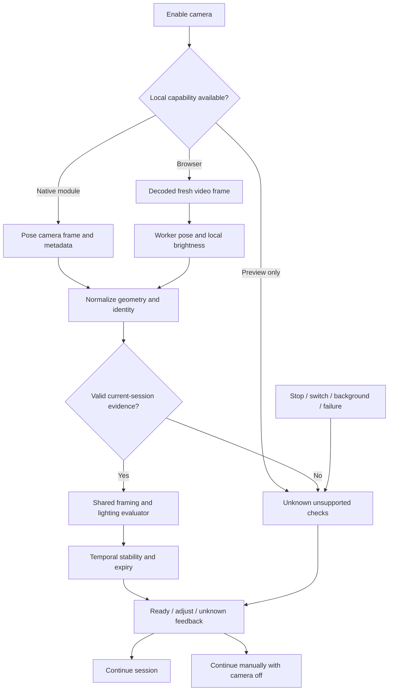

# Camera Readiness — Planning Research

**Researched:** 2026-10-20
**Scope:** Planning only; no implementation, dependency installation, branch, or commit.
**Confidence:** MEDIUM overall; source code and installed contracts inspected; device calibration remains unvalidated.

## User Constraints

- [USER DECISION, relayed by orchestrator] Use on-device checks and approximate framing guidance. Do not upload camera frames for readiness.
- [USER DECISION, relayed by orchestrator] Unsupported checks stay unknown. Permit manual workout continuation with the camera off.
- [USER DECISION] Planning only. No app-code edits, installs, branches, or commits in this research task.
- [SCOPE] Readiness is camera setup assistance, not form scoring, rep-counting enablement, a safety clearance, or a promise of measured camera distance.

## Project Constraints (from AGENTS.md)

- [VERIFIED: AGENTS.md, read this session] Use existing React hooks and API-backed persistence patterns; do not introduce Redux or another state-management library without approval.
- [VERIFIED: AGENTS.md, read this session] Read relevant installed Next.js guides before writing implementation code. This research does not write application code.
- [VERIFIED: C:/Users/MY PC/.codex/RTK.md, read this session] Prefix shell commands with RTK; preserve arguments, exit codes, and validation evidence.
- [CITED: .agents/skills/frontend-design/SKILL.md, read this session] Preserve intentional existing UI, accessible feedback, and plain user-facing copy. A visual redesign is unnecessary for readiness correctness.

## Summary

Use the installed pose stack through a readiness-specific adapter and one small, pure, shared evaluator. Keep browser and native acquisition separate; normalize full landmarks, image dimensions, preview geometry, frame identity, and brightness into the evaluator. Camera connection, visible body framing, scene lighting, and approximate subject size each require their own evidence and expiry. This is a proposed architecture, not a claim that these adapters already exist.

[VERIFIED: frontend/workers/pose.worker.ts:11-29; mobile/NativeTrackingCamera.tsx:40-50] Existing browser and native inference already obtain full pose results, but both adapters reduce them to rep-counting joints. Their output contains the verbatim expression `jointIndices` and fields `joints`, `aspect`, `timestamp`. The readiness path must retain whole-body evidence before that reduction.

[VERIFIED: node_modules/expo-mediapipe-pose/src/contracts.ts:72-100; android/src/main/java/expo/modules/mediapipepose/ExpoMediaPipePoseView.kt:320-338, within that package] Native readiness can reuse actual per-frame metadata: `width`, `height`, `cameraMirrored`, `cameraZoomFactor`, `receivedAtMs`, `frameNumber`, `luminance`, `poseCount`, `thermalState`. Lighting access is therefore available in this installed native module; do not add a native pixel-processing dependency merely to obtain a brightness scalar.

**Primary recommendation:** Local full-landmark framing plus locally measured scene brightness, temporal hysteresis, immediate invalidation, truthful unknown states, and an always-available manual continuation action. Calibrate on real devices before claiming reliable readiness.

## Architectural Responsibility Map

| Capability | Primary owner | Secondary owner | Planning recommendation |
|---|---|---|---|
| Camera permission and resource lifetime | Browser hook / native shell | UI | Own one camera; release on exit and camera-off continuation |
| Pose inference | Browser worker / native pose view | Platform adapter | Reuse installed models; do not move inference to the backend |
| Pixel brightness | Browser canvas / native metadata | Evaluator | Compute locally; do not serialize frames for readiness |
| Whole-body and framing checks | Shared pure evaluator | Geometry adapter | Evaluate visible preview coordinates and normalized source coordinates |
| Stability and expiry | Readiness hook/controller | Native lifecycle events | Track session identity and monotonic receipt time |
| User feedback and manual continuation | Existing camera-check screen | Native preview overlay | Render evidence-backed labels; never gate manual workouts on checks |
| Workout persistence | Existing API | Existing workout flow | No readiness media persistence or new database needed |

These are recommended responsibility assignments, not existing implementation declarations.

## Current Code and Exact Extension Points

| Inspected file | Existing behavior / evidence | Planned extension |
|---|---|---|
| `frontend/sections/Coach/CameraCheck.tsx` | [CITED: inspected source] Queries provider availability, captures a still, calls pose analysis on camera activation and explicit retry, and renders provider-derived results. Its start action is already unrestricted. | Replace only live readiness acquisition with local observation. Keep upload/workout analysis separate. Expose explicit camera-off manual continuation. |
| `frontend/lib/cameraReadiness.ts` | [VERIFIED: frontend/lib/cameraReadiness.ts:1-9,60-78] Declares `status: 'ready' | 'adjust' | 'unknown'`; readiness fields are `fullBody`, `lighting`, `distance`. The current numeric distance branch uses `metersValue >= 2.5 && metersValue <= 3`. | Preserve three-state semantics; remove readiness reliance on unverified meter values; present approximate framing language. Add a narrow internal evaluator contract rather than expanding permissive provider parsing. |
| `frontend/hooks/useCameraStream.ts` | [CITED: inspected source] Browser startup ignores video-play rejection before marking the camera on; frame capture separately checks decoded-data readiness and dimensions. Native bridge currently requests a base64 photo. | Expose actual frame freshness; invalidate on tracks ending/muting and lifecycle changes. Local readiness must bypass photo capture/upload. |
| `frontend/workers/pose.worker.ts` | [VERIFIED: frontend/workers/pose.worker.ts:11-29] Uses `runningMode: 'VIDEO', numPoses: 1, outputSegmentationMasks: false` and `delegate: 'CPU'`; obtains `result.landmarks[0]` before selecting rep joints. | Add a distinct readiness command/result, retaining all relevant landmarks and dimensions. Keep the existing rep frame shape compatible. |
| `frontend/hooks/useRepTracking.ts` | [CITED: inspected source] Already has one frame in flight, a video-time change check, adaptive sampling, worker startup timeout, stale-result handling, and teardown. | Reuse these lifecycle patterns, not the exercise-specific hook itself. Readiness must not require selecting an exercise or activate hidden tracking UI. |
| `mobile/App.tsx` | [VERIFIED: mobile/App.tsx:375-400,436-483] Existing capture branch calls `takePictureAsync({ quality: 0.45, base64: true, skipProcessing: true })`; native pose view is selected only for live-session tracking, while camera-check uses the ordinary camera view. | Route camera-check to the local pose camera when available; mount only one preview. Bridge compact observations/results with camera-session identity, not photo data. Replace static distance overlay text with current approximate framing feedback. |
| `mobile/NativeTrackingCamera.tsx` | [VERIFIED: mobile/NativeTrackingCamera.tsx:8-11,27-61] Availability uses `!isRunningInExpoGo()` and `requireOptionalNativeModule('ExpoMediaPipePose')`; existing active gating uses AppState and thermal handling. | Add a readiness mode independent of rep kind/side; preserve full landmarks and brightness metadata; clear on reconfiguration, backgrounding, failure, and camera change. |
| `shared/repCounter.ts` | [VERIFIED: shared/repCounter.ts:1-5] Types include `TrackingKind = 'squat' | 'curl'`, `TrackingFrame = { joints: Joint[]; aspect: number; timestamp: number }`. | Keep readiness independent of this three-joint exercise contract. Proposed new shared evaluator filename is a planning choice, not a pre-existing file. |
| `backend/src/providers/pose-analysis.provider.ts` | [VERIFIED: backend/src/providers/pose-analysis.provider.ts:7-22] Availability checks only `POSE_ANALYSIS_URL` and `POSE_ANALYSIS_API_KEY`; analysis posts payloads and accepts an object-valued `analysis` response. | No readiness backend dependency under the chosen design. Existing workout/upload provider remains outside this change. |

Paths in this table identify files opened this session; they do not claim a particular build or script creates them.

## Standard Stack

Reuse these installed dependencies. No installation or upgrade is recommended; no package legitimacy gate for a new dependency is needed.

| Existing asset | Declared version, verbatim | Evidence | Use |
|---|---|---|---|
| Browser pose package | `"@mediapipe/tasks-vision": "0.10.32"` | [VERIFIED: frontend/package.json:11-15] | Existing worker and hosted local WASM/model |
| Native pose package | `"expo-mediapipe-pose": "0.3.0"` | [VERIFIED: mobile/package.json:18-24; installed package source opened] | Full landmarks and brightness in a development/native build |
| Ordinary native camera | `"expo-camera": "~57.0.6"` | [VERIFIED: mobile/package.json:16-24] | Existing preview/manual fallback |
| Existing UI | `"react": "19.2.3"` | [VERIFIED: frontend/package.json:13-15] | Hooks and current UI state |

These are repository-declared versions, not assertions about latest registry versions. No registry lookup or package installation was performed.

[CITED: https://developers.google.com/edge/mediapipe/solutions/vision/pose_landmarker/web_js] Google documents browser pose inference as synchronous and recommends workers to avoid blocking the main thread. Keep the existing worker boundary.

## Architecture Patterns



Recommended pattern: platform adapters produce observations; the pure evaluator produces per-check decisions; a hook/controller manages stable display and expiry. Do not couple model loading, DOM operations, networking, and decision thresholds into one component.

### 1. Camera-connected must mean actual recent frames

[CITED: https://developer.mozilla.org/en-US/docs/Web/API/HTMLVideoElement/requestVideoFrameCallback] Browser video-frame callbacks identify newly presented video frames and supply timing/frame metadata. Prefer that signal where supported; fall back to decoded-data readiness, positive video dimensions, advancing video time, and a freshness watchdog. Track permission granted and camera configured separately from fresh-frame evidence.

[VERIFIED: node_modules/expo-mediapipe-pose/src/contracts.ts:78-88] Native payload contains `receivedAtMs`, `frameNumber`, `inferenceDurationMs`, `poseCount`. Require new frame identity for sustained connection readiness; a zero-person frame can still demonstrate camera delivery. Use locally monotonic receipt time for expiry. Native receive time is wall-clock based in the installed implementation; do not subtract it directly from browser monotonic time. [VERIFIED: node_modules/expo-mediapipe-pose/android/src/main/java/expo/modules/mediapipepose/ExpoMediaPipePoseView.kt:294-295; node_modules/expo-mediapipe-pose/ios/ExpoMediaPipePoseView.swift:263-264] Verbatim clock expressions: `System.currentTimeMillis()` and `Date().timeIntervalSince1970 * 1000`.

Camera covered by a hand is still connected if new frames arrive. Lighting and body checks can fail separately. A repeated cached result or a static test image is not evidence of continuing capture.

### 2. Whole-body visibility and aspect/crop geometry

[CITED: https://developers.google.com/edge/mediapipe/solutions/vision/pose_landmarker] Pose inference estimates body landmarks. It does not certify that an inferred, occluded body part is physically visible. Require finite in-frame coordinates and meaningful landmark visibility across head, shoulders, arms/hands, hips, knees, and feet; a returned landmark array alone must not pass the check.

[VERIFIED: node_modules/@mediapipe/tasks-vision/vision.d.ts:2304-2313; node_modules/expo-mediapipe-pose/src/contracts.ts:15-22] Web normalized landmarks declare `x`, `y`, `z`, `visibility`; native landmarks declare `visibility: Schema.optional(Confidence)` and `presence: Schema.optional(Confidence)`. Missing visibility is insufficient evidence. Validate presence when supplied, but do not require an undeclared web presence field or synthesize confidence for absent joints.

Recommended whole-body protocol: ask the user to stand in an unobstructed setup pose. Require head and both feet plus both limb chains with room at edges. Never use one shoulder/hip/ankle chain to assert the whole body is visible. Low-confidence joints remain unknown; clearly observed edge clipping produces adjustment guidance. Do not require every facial point at side angles without calibration. Whole-body readiness is stricter than exercise-specific rep tracking and must not block manual exercise.

[CITED: frontend/app/globals.css:6889-6896, inspected] The current browser preview uses cover cropping and mirrors the front-facing display. [CITED: node_modules/expo-mediapipe-pose/src/pose/skeleton.ts:42-65, inspected] The native package already implements an aspect-fill projection for upright, already-mirrored inference coordinates. Reuse or reproduce its small geometry formula in the shared adapter rather than projecting native coordinates twice.

Recommended geometry: for source size W,H and view w,h, cover scale is max(w/W,h/H); offsets center the scaled image. Project every required point into the visible viewport and test against a margin inside that viewport. Alternatively choose a contain preview consistently, accepting letterboxing. Decide once for camera-check; do not silently analyze an uncropped sensor view while claiming the cropped preview is ready. Reset stability after dimensions, orientation, zoom, lens, or facing changes.

### 3. Lighting uses image brightness, not pose confidence or ambient lux

[CITED: https://developer.mozilla.org/en-US/docs/Web/API/CanvasRenderingContext2D/getImageData] Canvas pixel reads provide local image channel samples. Use a tiny downsampled frame and a mean/percentile brightness statistic; never send it to an API. Failure to obtain pixels means unknown lighting.

[VERIFIED: node_modules/expo-mediapipe-pose/android/src/main/java/expo/modules/mediapipepose/ExpoMediaPipePoseView.kt:404-418; node_modules/expo-mediapipe-pose/ios/ExpoMediaPipePoseView.swift:305-320] Installed native code samples image pixels on a coarse grid and weights channels with the verbatim constants `0.2126`, `0.7152`, `0.0722`. Android normalizes via `return total / maxOf(1, count) / 255`. Reuse its normalized scene-brightness observation; avoid presenting it as calibrated illuminance.

Recommendation: expose only a conservative scene-lighting assessment in the initial slice. Mean brightness can miss a dark person against a bright background and camera auto-exposure changes the statistic. A body-region/backlight check would need additional native evidence beyond the global scalar and separate calibration; do not pretend the native scalar measures it. Unsupported lighting detail remains unknown. Use the same brightness scale on web and native, with platform calibration where results differ.

### 4. Distance becomes approximate framing guidance

[CITED: https://developers.google.com/edge/mediapipe/solutions/vision/pose_landmarker/web_js] MediaPipe world positions use the hip midpoint as origin; normalized depth is also relative to the hips. Therefore this output does not directly supply a measured camera-to-person range. Do not convert a landmark depth into meters from the camera.

Recommendation: label the row and pill as framing/position guidance or clearly mark distance as approximate. Compute person extent as a fraction of the effective visible viewport only after whole-body evidence is credible. Give move-back guidance for clear edge clipping; give move-closer guidance only when a complete, sufficiently confident body is visibly too small. No body, partial body, bent posture, bad geometry, poor visibility, or unavailable inference must not be misclassified as too far. Keep the current hard-coded meter-range rule out of local readiness. Do not ask height or add calibration/depth sensors for this slice.

### 5. Stability, staleness, and fail-safe semantics

[VERIFIED: frontend/lib/cameraReadiness.ts:1-3] Existing status vocabulary is exactly `'ready' | 'adjust' | 'unknown'`.

| State | Recommended evidence semantics |
|---|---|
| ready | Supported check, valid fresh same-session observation, stable pass |
| adjust | Supported check with fresh affirmative evidence of a correctable problem |
| unknown | Not assessed, unsupported, model not ready, permission unavailable, malformed evidence, ambiguous/occluded body, camera stopped, stale result, or lifecycle invalidation |

Recommended controller rules: attach a camera-generation identity to every async operation; accept only current-generation results; allow one inference in flight; drop obsolete work; never turn an old pass green after a newer failure. Invalidate immediately on camera stop, facing switch, screen exit, preview geometry change, permission loss, backgrounding, worker error, native inference error, or thermal pause. Recovery requires new evidence and a new stable window. Temporal smoothing must never preserve ready through camera disconnection or stale input.

[CITED: https://developer.mozilla.org/en-US/docs/Web/API/Page_Visibility_API] Browsers throttle background work, so timer frequency is not a reliable freshness guarantee. [CITED: https://reactnative.dev/docs/appstate] Native app state exposes foreground/background transitions; Android blur can occur without an AppState change. Handle visible-screen activity explicitly and clear readiness on loss of usable preview.

## Provisional Calibration — Not Product Guarantees

All numbers below are [ASSUMED] starting hypotheses for a small device experiment, not verified limits or locked user decisions. The planner should include calibration/validation rather than silently hard-code them as acceptance evidence.

| Parameter | Initial experiment | Evidence needed before shipping |
|---|---|---|
| Inference sampling | 5–10 observations/second with one in flight | Latency, heat, battery and responsiveness on target phones |
| Joint visibility | Begin near 0.65; test head/foot and side-view failure rates | Diverse users, clothes, poses, occlusions and cameras |
| Viewport edge margin | 3–5% of visible width/height | Actual preview matching across aspect ratios/orientations |
| Approximate body size | Experiment with 55–85% of visible height while standing | Tall/short users, camera tilt, field of view, side/frontal setup |
| Ready dwell | Around 0.8–1.2 seconds of continuous valid observations | No flicker, no premature green after entering/exiting frame |
| Unknown on stale input | Around 1–1.5 seconds, with immediate lifecycle invalidation | Slow phones and interruption behavior |
| Lighting | Derive ranges from captured local statistics; do not invent a universal pass cutoff | Dim/bright/backlit rooms across platforms; false-green analysis |

The existing counter's timing and angle thresholds are exercise heuristics, not readiness calibration evidence. Do not inherit them merely because they already exist.

## Expo Go and Development Build Capability

[VERIFIED: mobile/NativeTrackingCamera.tsx:8-11] Existing code explicitly requires `!isRunningInExpoGo()` and optional native module presence before loading the pose view. [CITED: https://docs.expo.dev/develop/development-builds/introduction/] A development build can include custom native libraries.

Recommended capability matrix:

| Surface | Camera | Readiness behavior |
|---|---|---|
| Supported secure browser | Existing getUserMedia preview | Local worker inference and canvas brightness, with capability checks |
| Native build containing installed pose module | One pose camera view | Full-landmark framing and metadata lighting |
| Expo Go / native build without pose module | Existing ordinary camera preview | Camera status only when supported evidence exists; pose/light/framing remain unknown; manual continuation stays available |
| Permission denied / unavailable camera | No active camera | Unknown checks with useful feedback; camera-off manual continuation |

Do not add photo polling, frame uploads, or WebView photo decoding merely to make Expo Go appear feature-complete. A later explicitly scoped local still-analysis fallback could be researched separately.

[CITED: https://docs.expo.dev/versions/latest/sdk/camera/] Expo camera documentation calls for one active preview and warns that skipped image processing can leave photo orientation uncertain. This reinforces choosing the pose camera as the sole local native readiness source rather than keeping ordinary CameraView and pose view open simultaneously.

## Alternatives Considered

| Approach | Strongest advantage | Limitation / disposition |
|---|---|---|
| Existing local MediaPipe | Reuses installed assets, avoids readiness image transfer, responds to local frame changes | Selected. Needs native routing, full-landmark normalization, calibration and device evidence. |
| External analysis provider | Could centralize richer image analysis and support ordinary-camera still capture | Rejected for readiness by user decision. Current provider is only an HTTP adapter; there is no verified remote readiness engine or calibrated distance contract. Configuration presence is not a health/accuracy guarantee. |
| Native depth/AR or calibrated camera ranging | Could address an explicitly calibrated metric-distance feature | Outside current scope; a separate hardware/calibration decision would be required. |

[VERIFIED: backend/src/providers/pose-analysis.provider.ts:7-22] External-provider configuration keys are exactly `POSE_ANALYSIS_URL` and `POSE_ANALYSIS_API_KEY`; response validation checks an object-valued `analysis`, not calibrated readiness evidence.

## Don't Hand-Roll

| Problem | Use instead |
|---|---|
| Body landmark model / detector | Existing installed MediaPipe runtimes and bundled/local model |
| New native camera or pixel pipeline | Existing pose camera and its luminance metadata |
| Client state framework | React hooks and a pure evaluator |
| Metric ranging from monocular landmarks | Approximate viewport framing; unknown when unsupported |
| Background processing orchestration | Existing lifecycle APIs, cleanup and generation guards |
| Readiness network service or database | Ephemeral local observations; none needed |

## Common Pitfalls

- Treating granted permission, successful camera configuration, or model initialization as proof of fresh delivered frames.
- Declaring full body from three rep joints, a pose count, or low-confidence inferred feet.
- Testing source-image bounds while the preview crops out the user's head or feet; double-mirroring native coordinates.
- Treating bright backgrounds as proof that the person is well lit; treating scene brightness as physical lux.
- Calling a small partial pose too far away; interpreting hip-relative model depth as camera distance.
- Leaving readiness green after a camera switch or background transition; accepting late results from an old camera session.
- Keeping ordinary native camera and pose camera mounted together; using repeated photos as if they were live inference.
- Sending readiness frames through the existing provider API despite the chosen local-only scope.
- Accidentally enabling hidden rep-counting routes while reusing inference assets.
- Disabling workout continuation because an optional camera setup check is unknown.

These are failure cases the proposed tests must exercise, not claims that all are presently observed in production.

## Code Examples — Verified Existing Contracts

Installed web signature, quoted verbatim; retain a monotonic video timestamp and the worker boundary:

```ts
// node_modules/@mediapipe/tasks-vision/vision.d.ts:2541
detectForVideo(videoFrame: ImageSource, timestamp: number): PoseLandmarkerResult;
```

[VERIFIED: node_modules/@mediapipe/tasks-vision/vision.d.ts:2541,2598-2608] Result fields are `readonly landmarks: NormalizedLandmark[][];` and `readonly worldLandmarks: Landmark[][];`. Readiness should consume the former for image framing; the latter is not a camera ranging API.

Native observation fields, quoted verbatim:

```ts
// node_modules/expo-mediapipe-pose/src/contracts.ts:78-88
width: Positive,
height: Positive,
cameraFacing: CameraFacing,
cameraLens: Schema.Literal("wide", "ultraWide"),
cameraMirrored: Schema.Boolean,
cameraZoomFactor: Finite.pipe(Schema.between(1, 100)),
receivedAtMs: NonNegative,
frameNumber: NonNegative.pipe(Schema.int()),
inferenceDurationMs: NonNegative,
luminance: Confidence,
poseCount: NonNegative.pipe(Schema.int()),
```

[VERIFIED: node_modules/expo-mediapipe-pose/src/contracts.ts:78-88] These fields already exist; the work is to preserve and normalize them through the readiness adapter. The normalization/result shape is a new design choice for the planner, not a claim about an existing public API.

## Validation Architecture

No test suite was run by this planning-only research. Commands below are proposed execution checks, not passing results.

[CITED: frontend/tests/mobile-redesign.test.mjs:185-233, inspected] Existing camera tests include source-string assertions plus execution of the provider-result parser with synthetic inputs. The test supplies a synthetic meter value; it does not measure a person. [CITED: backend/test/pose-analysis.spec.ts, inspected] Backend tests substitute a mocked provider and verify availability/pass-through. They do not verify inference quality or the remote provider. [CITED: frontend/tests/browser/pose-tracking.spec.mjs, inspected] Existing browser tests mock APIs and cover hidden rep-counting routes/library access, not real camera readiness.

| Planned verification | Layer | What it establishes |
|---|---|---|
| Pure evaluator tests with synthetic landmarks and brightness | Unit | Geometry, finite/range validation, all statuses, missing evidence, edge margins and distinct lighting/body outcomes |
| Fake-clock controller tests | Unit/integration | Stable-window behavior, expiry, duplicated frames, out-of-order events, camera generation and resume |
| Worker/bridge tests | Integration | Full-landmark payloads, brightness normalization, dimension/mirror handling, one in-flight job, resource disposal and error cleanup |
| Browser camera-check interaction with mocked acquisition | Browser | Actionable UI states, denied/unavailable paths, no camera-readiness API requests, manual continuation with camera release |
| Physical browser/phone sessions | Hardware/manual | Real capture, inference, crop alignment, lighting reliability, responsiveness and model compatibility |

Proposed quick regression commands from repository root:

```powershell
rtk proxy node --test frontend/tests/mobile-redesign.test.mjs frontend/tests/pose-flow.test.mjs
rtk npm --prefix backend test -- test/pose-analysis.spec.ts
```

[CITED: frontend/package.json and backend/package.json, inspected] Frontend uses Node's built-in tests in these files; backend has a Vitest test script. Add a focused evaluator/controller test file to that existing style rather than installing a framework. Proposed new test filenames and commands must be finalized in the phase plan. Existing provider-specific source assertions need intentional updates for local readiness; preserve relevant upload/workout behavior assertions.

Hardware matrix: front/back cameras; portrait/landscape and rotated capture; narrow/wide preview; user stepping in/out; feet/head/hands cropped; side-on stance and occlusion; different body sizes, clothing and skin tones; dim/bright/backlit scenes; camera cover; permission revocation; app switch/notification shade; device lock/unlock; camera busy; worker/model-load failure; low-performance/thermal operation; rapid camera switching; screen exit and manual continuation. Record observed false-green cases and threshold changes. Synthetic tests cannot replace this evidence.

Privacy acceptance: intercept browser/backend requests while local readiness runs; assert no readiness image payload or readiness analysis request. Also check native bridge payloads/logging: only compact local observations or decisions, no base64 images. Confirm camera resource release on manual continuation, navigation and lifecycle invalidation.

## Security Domain

[CITED: https://owasp.org/projects/asvs] OWASP identifies ASVS 5.0.0 as stable and advises versioned references because identifiers change. Do not carry old category numbers into this plan without checking the matching standard version.

Applicable control families for this local feature are input validation, web/bridge encoding, data protection/privacy, and lifecycle/resource limits. Existing API authentication/session/access control remain relevant to workout persistence but require no new readiness endpoint or credentials. This is a recommended threat mapping, not an ASVS compliance claim.

| Threat | Standard planning control |
|---|---|
| Invalid or forged bridge payload marks ready | Validate fields, finite numbers, confidence bounds, expected session identity and monotonic sequence; unsupported becomes unknown |
| Stale async result from old camera | Generation guards, cancellation and immediate invalidation |
| Readiness image disclosure | No frame uploads/persistence or base64 logging; transient in-memory samples only |
| UI freeze or retained camera resources | Worker inference, one job in flight, bounded sampling, teardown and stale watchdog |
| Injected content through native script bridge | Continue existing JSON serialization/escaping; fixed event structure, no executable provider text |

## Environment Availability

| Dependency | Observation this session | Execution implication |
|---|---|---|
| Node | [VERIFIED: command output] `v24.19.0` | Existing source tests can be run by executor |
| npm | [VERIFIED: command output] `11.17.0` | Existing workspace tooling present |
| Browser/native pose libraries | [CITED: installed source/type files opened] Available under root workspace dependencies | Reuse; no install requested |
| Context7 MCP / ctx7 CLI | [CITED: tool inventory and command probe] No callable Context7 tool or CLI found in this session | Used official docs and installed contracts instead; installed no lookup tool |
| Android device/debug bridge | [CITED: command probe] No adb command resolved on PATH; device availability was not established | Physical validation remains an execution checkpoint; do not infer no Android SDK/device exists |
| iOS development build/device | Not probed | Require explicit hardware/build evidence during execution |
| External pose readiness service | Not probed or used | Not required by selected local design |

## Assumptions Log and Open Questions

| Item | Unresolved evidence | Planning treatment |
|---|---|---|
| [ASSUMED] Sampling, confidence, margins, body-size ratio, dwell and expiry hypotheses in calibration table | Target-device observations | Calibrate in a bounded validation task; unknown on unsupported evidence |
| [ASSUMED] Conservative global brightness can support a useful initial lighting indicator | Platform/user/backlight measurements | Do not ship an accuracy guarantee; narrow copy and retain unknown when ambiguity cannot be resolved |
| Native module present in intended installed build | Actual app/device capability probe | Keep preview/manual fallback and document development-build requirement |
| Preferred preview geometry | Product/layout choice: cover with coordinate projection versus contain | Preserve existing layout unless small, verified adjustment makes framing clearer; test actual visible bounds |
| Exact whole-body landmark policy across side view and mobility differences | Representative device/use-case evidence | Avoid requiring all face points; explain uncertainty and keep manual continuation |

## Research Method and Sources

The GSD research-plan seam was invoked through the installed identity-verified runtime (`@opengsd/gsd-core`, `1.15.0`). It selected Context7 for library questions and websearch for browser questions. Context7 tools and CLI were unavailable, so primary official documentation and installed source/contracts were used. The classify-confidence seam returned MEDIUM for cross-checked websearch evidence. Graph status reported disabled; no semantic graph assertions were used. No new package installation was proposed. Research-store cache writes were omitted to keep project changes confined to this assigned artifact.

Primary sources read:

- [Google Pose Landmarker web guide](https://developers.google.com/edge/mediapipe/solutions/vision/pose_landmarker/web_js) — inference threading and image/world coordinate definitions; page updated 2026-08-17.
- [Google Pose Landmarker overview](https://developers.google.com/edge/mediapipe/solutions/vision/pose_landmarker) — pose landmarks/model scope; page updated 2026-10-09.
- [Expo camera documentation](https://docs.expo.dev/versions/latest/sdk/camera/) — one active preview, capture readiness and orientation caveats; installed types/source take precedence for the repository version.
- [Expo development builds](https://docs.expo.dev/develop/development-builds/introduction/) — custom native library capability.
- [MDN video-frame callback](https://developer.mozilla.org/en-US/docs/Web/API/HTMLVideoElement/requestVideoFrameCallback), [canvas pixel reads](https://developer.mozilla.org/en-US/docs/Web/API/CanvasRenderingContext2D/getImageData), [page visibility](https://developer.mozilla.org/en-US/docs/Web/API/Page_Visibility_API) — browser primitives.
- [React Native AppState](https://reactnative.dev/docs/appstate) — lifecycle and Android blur; page updated 2026-09-27.
- [Installed native module upstream](https://github.com/YosefHayim/expo-mediapipe-pose) — package identity cross-reference; installed source was inspected directly for actual contracts and luminance calculations.
- [OWASP ASVS](https://owasp.org/projects/asvs) — versioned verification-reference guidance.

Local sources were opened this session as cited above. No real camera measurements, remote pose-provider tests, native builds, or hardware sessions were performed. Source/type evidence supports the architecture; calibration and device reliability remain execution work.
