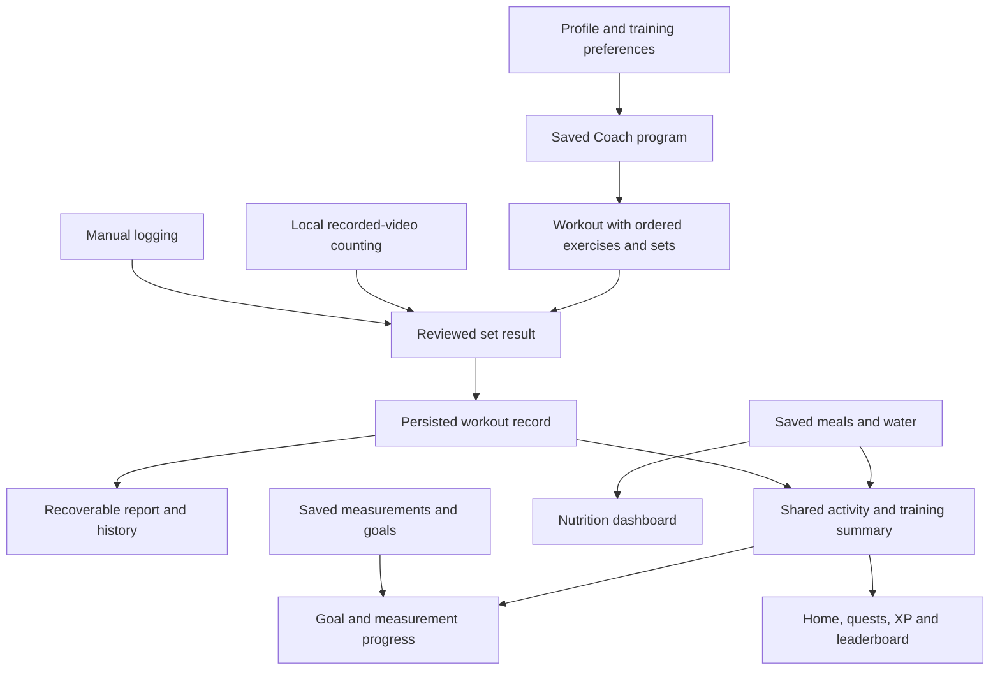

# PhysiqueQuest: connected feature implementation plan

Reviewed October 17, 2026. Scope: feature relationships, shared data, workflow recovery, and backend efficiency. This is a research and planning document; it does not implement the proposed architecture.

Implementation follow-up: [connected feature changes, evidence and rollout checks](COHESIVE_FUNCTIONS_IMPLEMENTED.md). The original findings below are retained as the pre-change audit.

## 1. Plan and research method

1. Trace profile/preferences → Coach program → exercise selection → session/recorded set → report → progress/goals/activity.
2. Trace food scan/manual meal/water → nutrition → dashboard/activity/leaderboard.
3. Identify conflicting definitions, missing references, repeated requests, and state lost during navigation.
4. Compare solutions with the installed Next.js guides and official React, MongoDB, and NestJS documentation.
5. Implement later in small phases, validating one complete saved user journey before extending it.

The best fit is the existing NestJS application organized into focused services, with shared data contracts and React hooks. Keep local video analysis. Reuse the current service boundaries and saved Coach programs. Adding a global state library or more backend services is unnecessary for the identified gaps.

## 2. Findings confirmed in current source

| Connection | Current behavior | Consequence |
| --- | --- | --- |
| Coach plan → workout execution | `CoachSection.tsx` saves all chosen exercise IDs, but passes only `sessionExercises[0]` to `LiveSession`. Normal completion submits no exercise results. | A multi-exercise plan does not yet have a matching execution/logging flow. |
| Uploaded clip → planned exercise | `RecordedRepCounter.tsx` independently selects a local tracking preset and creates a completed workout. There is no plan/day/exercise/set reference. | The clip cannot reliably complete the corresponding set in the chosen program. |
| Completed workout → rewards/goals | `ActivityService` awards workout XP per activity day; `LeaderboardService` adds 100 points per completed workout document; Goals counts completed documents against planned training days. | Multiple clips on one day can produce inconsistent progress and credit. This follows from the current definitions; it was not exercised against a live account. |
| Reports → history | The active workout and displayed report are component state; the workout controller has list/create/pause/complete but no detail or active-session endpoint. | Reloading cannot reconstruct the same report/session through a dedicated route. |
| Exercise identity → results | Local `camera-*` preset IDs and provider IDs coexist. Reports print raw IDs; Progress infers names from IDs and excludes ObjectId-shaped IDs from load records. | Names and exercise comparisons are unreliable across sources. Sharing a counting algorithm does not make two exercise variations the same exercise. |
| Workout history → summaries | The list API defaults to 20 records and caps at 100. Progress/Goals use the default; Activity requests 100 while computing historical XP/streaks. | A recent list is being used as a substitute for historical and date-range queries. Older history can be omitted. |
| Meals/water → other views | `useNutrition` already publishes confirmed snapshots and guards stale refreshes. Activity and workout hooks do not share this refresh behavior. | The same mutation can update one view while another keeps its previous values until remount/refresh. |
| Activity read → database write | `useActivity.refresh()` calls PUT with the timezone every time; backend update saves before computing the response. Backend activity reads also invoke an upsert for user state. | Ordinary viewing performs avoidable writes. |
| Profile → preferences/targets | Coach can read equipment/duration from Settings before Profile; Home uses constant nutrition targets from `Scan/types.ts`. | Preference precedence needs a clear owner. Displaying a profile goal does not mean nutrition targets are personalized. |
| Dates → daily/weekly progress | Activity uses the stored IANA timezone and workout end time. Goals uses browser-local week boundaries and workout start time. Leaderboard applies its own period rules. | Midnight/week-boundary activity can be attributed differently. |
| Navigation → native shell/state | `navigate()` uses `window.location.assign`; account pages separately fetch the profile. | Internal navigation reloads documents and rebuilds app state, contributing to loading and recovery friction. |
| Safety settings → workout behavior | Coach supplies the threshold, while the session starts the native monitor independently of the inactivity toggle. Pause does not explicitly pause the native monitor. | Settings, pause state, and native behavior need one documented lifecycle policy. |

Existing code already provides useful foundations: persisted Coach programs keyed by preference context, authenticated workout records, server-derived workout duration, local rep counting, saved nutrition, measurements, and API-backed activity. The older remaining-work checklist predates the local uploaded-video changes; its upload-to-provider findings should not be treated as the current recorded-video flow.

## 3. The intended feature relationships

Each connection carries a specific persisted identifier or confirmed result. Navigation alone is not a data connection. A count is a set result, a collection of sets belongs to a workout, and a workout may fulfill a program day. Measurements and food logs retain their own meanings.

## 4. Establish the shared contracts first

### Exercise identity and tracking capability

Give each exercise variation a stable internal ID and a saved display-name/equipment snapshot. Preserve provider references and legacy IDs. Define explicit mappings between supported catalog exercises and the seven local presets; do not enable tracking through fuzzy name matching. Unmapped exercises remain manually loggable.

Keep variation identity separate from movement family: goblet and sumo squats can share knee-angle counting while retaining separate history. Each tracking capability declares its movement rule, required joints, camera guidance, supported input mode, and algorithm version. Only render capabilities that are available on the current device. Recorded-video worker support and native live-camera support are different capabilities.

### Workout, exercise, and set records

Extend the existing workout document with optional program ID/version, selected day, ordered exercise snapshots, and set results. Each set needs a stable ID, exercise ID, order, reps, optional load, completed/skipped state, and input source (`manual` or `local-video`). For counted sets retain detected reps, reviewed reps, selected side, algorithm version, and clip duration; do not store video or landmark streams.

Make `planned`, `standalone`, and `recorded-set` origins distinguishable. Uploading from an active exercise should attach to that exercise/set. If the video represents a different exercise, let the user choose to add it or log it separately. Never silently satisfy a prescribed exercise with a different preset.

Distinguish workout start/end time, set duration, clip duration, and when the exercise was actually performed. An imported recording needs a user-visible activity date; its file duration does not establish its original recording date. Preserve old fields through a compatibility adapter while new clients and summaries migrate.

### Shared activity rules

Recommended initial rules, to be made explicit in the product:

- A recorded clip logs a set; it does not automatically create an extra training day or completed program.
- A user explicitly finishes a session after reviewing completed/skipped sets. Skipped exercises must remain visible, rather than being reported as completed.
- The existing daily workout mission awards credit once per qualifying training day. Use the same workout-credit policy for XP and leaderboard workout points.
- A goal phrased as “train three days per week” counts distinct qualifying training dates, not three clips or sessions on one date.
- Preserve separate meanings for best reps and best load. Do not infer lifted weight, form quality, calorie expenditure, or a medical recommendation from rep counts.
- Meals and water continue to drive their own missions; lifting a weight should not automatically log water or change nutrition targets.

Use an explicit IANA timezone for daily records and preserve attribution when a result is saved. Define a common competition boundary for leaderboard periods, such as UTC, and display it; this can differ intentionally from personal local-day goals. Add rules for backdated records and timezone changes so editing time settings cannot duplicate credit.

## 5. Implementation sequence

### Phase 1 — Make recording and completion reliable

Extend the workout schema/DTOs with exercise/set snapshots, origins, program references, stable operation IDs, and a revision. Add authenticated detail and active-session retrieval, set save, and completion operations. Keep per-frame processing entirely local and save at user actions such as confirming a set, pause/resume, and completion.

Make mutations idempotent in the database: a unique owner/operation key returns the original result on a replay; reusing a key for a different payload is a conflict. Use conditional atomic updates on expected revision/status to prevent simultaneous requests from overwriting results. Client busy flags and returning completed records are useful UX but do not solve concurrent requests or lost create responses.

For standalone imported results, prefer one atomic operation that creates the finished record instead of separate create-then-complete requests. For an existing session, save the set into that session. MongoDB documents single-document updates as atomic; related bounded session/set data therefore fits the current document model. Use transactions only if a future invariant must span documents. [MongoDB atomicity and transactions](https://www.mongodb.com/docs/manual/core/write-operations-atomicity/)

Done when a timeout/retry creates one logical result, two concurrent requests cannot duplicate a set/completion, and a saved session/report can be reloaded by ID.

### Phase 2 — Connect the actual workout journey

Introduce a session reducer for clear transitions: setup → active ↔ paused → review → saving → completed. Video analysis has its own cancellable loading/counting state. Model failure returns to manual set review, without erasing completed results.

Guide users through the prescribed exercise queue and set list. Show the selected exercise's instructions and available logging modes. Carry the exercise and set IDs into video counting, validate reviewed reps/load, and let users advance or skip. Keep unsupported exercises accessible through manual logging.

Use React hooks, a reducer, and a narrowly scoped session context. Avoid copying profile, workout, and derived totals across multiple unrelated component states. This follows React's guidance on avoiding contradictory/duplicated state and using reducers/context for coordinated screens. [State structure](https://react.dev/learn/choosing-the-state-structure), [Reducer and context](https://react.dev/learn/scaling-up-with-reducer-and-context)

Done when a three-exercise program can be logged through manual/video inputs, paused, resumed, reviewed, saved, and restored without losing exercise/set identity.

### Phase 3 — Make Home, Progress, Goals, and rewards agree

Create a shared server summary service that reads canonical workout, nutrition, and measurement records. Centralize completion eligibility, local-day attribution, weekly training days, and workout-credit rules. Export that service through existing Nest modules so different controllers reuse it rather than calling one another. [NestJS modules](https://docs.nestjs.com/modules)

Use date-range aggregations and indexed queries instead of fetching the latest 20/100 rows for historical totals. Candidate indexes include owner/status/end time for summaries and owner/start time for history; validate them with explain plans and actual query shapes. Pagination serves history browsing, not lifetime statistics.

Separate timezone/settings updates from activity GET requests. Initialize required settings once, then keep normal reads free of application writes. After a confirmed mutation, update the affected resource and invalidate only its dependent summaries. Extend the existing nutrition refresh pattern through shared hooks, with request deduplication, cancellation, and account-scoped caches. Clear cached state on logout/account changes.

Start with derived summaries for correctness and modest complexity. Cache or maintain daily aggregates only if measured query costs justify it. Durable reward ledgers or asynchronous consumers would need idempotency and recovery; an in-memory event notification alone must not be the only record of a reward.

Done when completing a workout changes the report, today's mission, weekly goal, and leaderboard according to the same policy; multiple recorded sets on one day do not multiply daily credit; older history remains included.

### Phase 4 — Connect preferences, nutrition, navigation, and recovery

Choose one owner for training preferences and expose one typed resolved view to Home/Coach. Migrate conflicting Profile/Settings values deliberately. Preserve the existing saved-program hash/version behavior so reopening a page does not generate a new program.

Make nutrition targets persisted user configuration with an explicit source/default, consumed by both Home and food logging. The current constants can be a clearly described default during migration. Any automated target calculations require a separately specified, validated policy; exercise rep counts should not invent calorie adjustments.

Use Next.js internal links/router transitions for app navigation. Provide detail routes for workouts and reports. Recover the authoritative session from the backend and persist a small account-scoped draft for unsaved reviewed input; retain only minimal metadata, never media. Prefer an active-session lookup plus a lightweight resume banner to mounting camera resources globally. The installed Next.js 16.3.8 guides and current docs describe internal navigation, prefetching, and persistent layouts. [Next.js navigation](https://nextjs.org/docs/app/getting-started/linking-and-navigating)

Bind the native monitor to the workout lifecycle and documented settings. Explicitly decide pause behavior and alarm-volume semantics; test start/stop, interruptions, permissions, and cleanup on physical devices. Upload analysis by itself should not start a workout safety monitor. Optional camera/provider availability must not block manual logging, food logging, or access to saved reports.

Done when returning from Me/Progress resumes the correct session, preferences agree across screens, and the same saved meal/water change updates nutrition and applicable missions.

## 6. Migration and verification

Use additive fields and versioned adapters first. Retain old workout IDs and records. Do not assume that past `camera-*` sessions were complete programs or that an old raw provider ID has an unambiguous local equivalent. Show legacy data honestly; backfill only mappings and facts that can be verified. If reward definitions change, version the policy and explain any recalculation instead of silently rewriting history.

Verification must cover behavior across features:

1. A planned three-exercise workout saves all sets and reopens the same report after reload.
2. A supported uploaded push-up clip attaches to the intended set; changing exercise requires an explicit action.
3. Cancelling analysis, losing model/codec support, or hiding the app releases resources and retains manual logging.
4. Concurrent saves, a lost create response, a lost completion response, and repeated retries produce one logical operation.
5. Three sets on one day produce the agreed daily/weekly credit; XP and leaderboard use the same workout-credit definition.
6. A workout crossing local midnight, a week boundary, timezone changes, backdating, and unit conversion behave consistently.
7. More than 100 historical workouts do not truncate lifetime XP or date-range goals.
8. Scan → reviewed meal save → Home totals → mission progress reads back the same server-confirmed data.
9. Logout/account switching never restores another user's drafts or cached summaries.
10. Physical Android/iOS checks cover navigation, safe areas, video decoding, counting accuracy, pause behavior, and native monitor cleanup.

Record request counts, write counts, query execution plans, payload sizes, startup time, and clip processing time before and after the first vertical slice. The intended budget is zero video uploads, zero backend inference for rep counting, zero periodic rep writes, no settings write on ordinary refresh, and saves proportional to confirmed sets/lifecycle actions. Do not claim latency, battery, or accuracy improvements without measurements.

## 7. Summary

Build the connections around one persisted workout with explicit exercises and sets. Manual entry and local video counting should feed the same reviewed-result path; reports, history, goals, quests, XP, and leaderboard should derive from shared definitions. Keep meals, water, measurements, preferences, and safety connected only through relationships that have a clear product meaning.

Implement data identity and reliable saving first, the full workout journey second, shared summaries/rewards third, and preferences/navigation/native recovery fourth. This preserves the current lightweight video processing while addressing the main inconsistencies and unnecessary backend work. No application code was changed during this planning pass.
