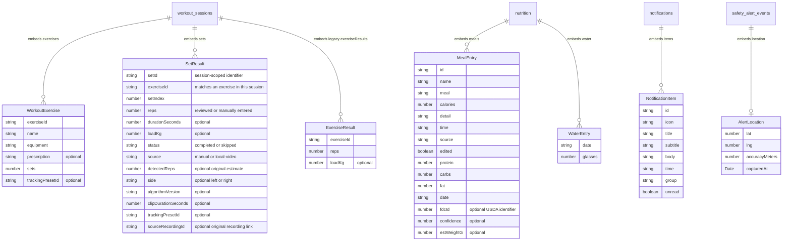

# PhysiqueQuest entity relationship diagram

Current backend model, checked against the Mongoose schemas and module registrations on October 17, 2026. This describes the application schema, not an inspection of a deployed database.

## Visual and editable versions

Open [PhysiqueQuest-ERD.drawio](diagrams/PhysiqueQuest-ERD.drawio) in diagrams.net or a draw.io editor. It contains two editable pages: collection relationships and embedded objects. Tables, fields, and connections are editable shapes rather than flattened screenshots.

- Collection image: [PNG](diagrams/ERD-collections.png) or [SVG](diagrams/ERD-collections.svg).
- Embedded-data image: [PNG](diagrams/ERD-embedded.png) or [SVG](diagrams/ERD-embedded.svg).
- Mermaid sources: [collections](ERD.mmd) and [embedded data](ERD-embedded.mmd).

The collection image shows key fields for readability; the definitions below provide more detail. Regenerate the visual files after schema updates with `python docs/generate_erd_visuals.py`; the layout and key-field summaries are maintained in that script.

## Collection relationships

There are **14 active collections**. MongoDB references are not database-enforced foreign keys. `PK` means MongoDB document identity; `UK` means a declared unique index. Relationship lines show intended ownership. A user may have no document yet in an optional one-per-user collection.

```mermaid
erDiagram
    direction LR
    users ||..o| profiles : "userId"
    users ||..o| settings : "userId"
    users ||..o| activity : "userId"
    users ||..o| nutrition : "userId"
    users ||..o| notifications : "userId"
    users ||..o{ workout_sessions : "userId"
    users ||..o{ progress_entries : "userId"
    users ||..o{ coach_programs : "userId - application link"
    users ||..o{ leaderboard_snapshots : "subjectId"
    users ||..o{ safety_alert_events : "userId"
    users ||..o{ sign_in_events : "userId"
    users ||..o{ password_recovery_tokens : "userId"
    workout_sessions |o..o{ safety_alert_events : "optional workoutSessionId - unverified link"

    users {
        ObjectId _id PK
        string email UK
        string name
        string passwordHash
        string role "user or admin"
        boolean isActive
        number failedLoginAttempts
        Date lockoutUntil "nullable"
    }
    profiles {
        ObjectId _id PK
        ObjectId userId UK
        string name
        string age
        string height
        string heightUnit
        string weight
        string weightUnit
        string gender
        string activity
        string goal
        string targetWeight "optional"
        string targetDate "optional"
        string seriousness
        string_array equipment
        string_array days
        string duration
        string_array conditions
        string healthNotes
        string contactName
        string contactPhone
    }
    settings {
        ObjectId _id PK
        ObjectId userId UK
        Mixed values "preferences and nutrition targets"
    }
    activity {
        ObjectId _id PK
        ObjectId userId UK
        Mixed state "timezone and legacy state"
    }
    nutrition {
        ObjectId _id PK
        ObjectId userId UK
        MealEntry_array meals "embedded"
        WaterEntry_array water "embedded"
    }
    notifications {
        ObjectId _id PK
        ObjectId userId UK
        NotificationItem_array items "embedded"
    }
    workout_sessions {
        ObjectId _id PK
        ObjectId userId
        string_array exerciseIds
        Date startedAt
        Date endedAt "optional"
        Date pausedAt "optional"
        number pausedSeconds
        string status "active or completed"
        number durationSeconds "optional"
        WorkoutExercise_array exercises "embedded snapshots"
        SetResult_array sets "embedded"
        string_array appliedRecordingIds "server assigned source claims"
        ExerciseResult_array exerciseResults "legacy totals"
        number revision
        string origin "planned, standalone, recorded-set"
        string requestKey "optional compound unique key"
        string requestHash "optional"
        string completionHash "optional"
        string programVersion "optional context hash"
        number dayIndex "optional"
        string scheduledDate "optional selected plan date"
        string timezone "optional"
        string activityDate "optional"
        number creditPolicyVersion "optional"
    }
    progress_entries {
        ObjectId _id PK
        ObjectId userId
        string metric "weight, waist, benchPress"
        number value
        string unit "kg, lb, cm, in"
        Date measuredAt
    }
    coach_programs {
        ObjectId _id PK
        ObjectId userId "no Mongoose ref declaration"
        string contextHash "compound unique with userId"
        Mixed plan "embedded program snapshot"
    }
    leaderboard_snapshots {
        ObjectId _id PK
        ObjectId subjectId
        string period
        string boundaryKey
        number rank
        number points
        number creditPolicyVersion "optional"
    }
    safety_alert_events {
        ObjectId _id PK
        ObjectId userId
        string idempotencyKey "compound unique with userId"
        string eventType "manual, inactivity, cancelled"
        string status "pending, delivered, failed, cancelled"
        string errorCode "optional"
        string providerReference "optional"
        Date occurredAt
        ObjectId workoutSessionId "optional, no Mongoose ref"
        string exerciseId "optional"
        AlertLocation location "optional embedded object"
        Date resolvedAt "optional"
        boolean flagged
    }
    sign_in_events {
        ObjectId _id PK
        ObjectId userId
        Date occurredAt
        string source "login or register"
    }
    password_recovery_tokens {
        ObjectId _id PK
        ObjectId userId
        string tokenHash UK
        Date expiresAt "TTL index"
        Date usedAt "nullable"
    }
    admin_exercises {
        ObjectId _id PK
        string name
        string slug
        string group
        string status "draft or published"
        string pose "missing, ready, training"
        string targetMuscle
        string equipment
        string difficulty
        string pictureUrl
        string videoUrl
        string_array instructions
        string trackingStatus
    }
```

All collections above enable Mongoose timestamps (`createdAt`, `updatedAt`); these are omitted from the boxes for readability. Profile also stores optional `heightInches`, `chest`, `waist`, `arms`, their individual units, legacy `measurementUnit`, and `contactRelationship`.

`admin_exercises` is a shared catalog, so it has no user ownership edge. Workout exercise IDs are strings that can identify external catalog exercises or local tracking presets; they are **not declared references to `admin_exercises._id`**.

## Embedded document detail

The child boxes below are **objects stored inside their parent documents**, not additional collections. Their string IDs are application identifiers, not MongoDB `_id` fields. Embedded cardinality means containment.

`workout_sessions.exercises` and `sets` are persisted as arrays of generic objects; their detailed shapes come from `backend/src/workouts/workout-contract.ts` and request validation. `coach_programs.plan`, `settings.values`, and `activity.state` use MongoDB Mixed fields rather than independently registered child schemas.

## Keys and relationship limits

| Collection | Declared unique constraint beyond `_id` |
|---|---|
| `users` | `email` |
| `profiles`, `settings`, `activity`, `nutrition`, `notifications` | `userId` in each collection |
| `coach_programs` | `(userId, contextHash)` |
| `workout_sessions` | `(userId, requestKey)` where `requestKey` is a string; `(userId, appliedRecordingIds element)` where the array contains strings, a unique multikey index |
| `leaderboard_snapshots` | `(period, boundaryKey, subjectId)` |
| `safety_alert_events` | `(userId, idempotencyKey)` |
| `password_recovery_tokens` | `tokenHash`; `expiresAt` also has an expiry index |
| `progress_entries`, `sign_in_events`, `admin_exercises` | No additional unique constraint declared |

These are schema-declared constraints; this document does not verify whether an existing deployment has created every index. Recovery-token expiry uses MongoDB TTL cleanup, which is asynchronous.

- User ownership fields declare `ref: 'User'`, except `coach_programs.userId`, which is an application-level link. `leaderboard_snapshots` uses `subjectId` for its user reference.
- A planned workout can carry `programVersion`, which corresponds to a coach program's `contextHash` for that user, plus `dayIndex` and `scheduledDate`. This is contextual linkage, not a `coachProgramId` reference or guaranteed join. `scheduledDate` anchors new planned sessions to the selected calendar date; older sessions fall back to their weekday in the week they started. Standalone recordings use their performed activity date. There is no extra program-to-workout foreign key in the main diagram.
- `safety_alert_events.workoutSessionId` is an optional ObjectId. The safety service accepts and stores it without querying the workout, so the dotted line expresses intended association, not verified existence or ownership of the target session.
- Settings contain shared nutrition targets inside `values.nutritionTargets`. Training preferences and emergency-contact details live in `profiles`; the emergency contact is not another user entity.
- XP, levels, streaks, missions, badges, workout records, and current leaderboard standings are derived from application data. They are not separate collections. `leaderboard_snapshots` stores historical standings.
- Pose analysis runs locally. Saved set results can contain counts and analysis metadata; this model has no stored video, frame, or pose-landmark collection. Push-ups use the same workout/set structure as other exercises.
- A planned set may carry `sourceRecordingId`, a string containing its original recorded-set workout ID. The server checks source ownership, performed date and positive results before applying it. `appliedRecordingIds` on the planned workout reserves those source IDs across workouts; ordinary set edits preserve provenance. This is a validated application-level self-reference to `workout_sessions`, not a new collection or declared Mongoose `ref`.
- `backend/src/exercise/exercise.schema.ts` defines an older `Exercise` schema, but no active backend module registers it. It is excluded from this runtime ERD; this does not establish whether an older deployment still contains an `exercises` collection.

## Source map

| Domain | Schema source, relative to the repository root |
|---|---|
| Accounts | `backend/src/auth/schemas/user.schema.ts` |
| Authentication events | `backend/src/auth/schemas/sign-in-event.schema.ts` |
| Recovery tokens | `backend/src/auth/recovery-token.schema.ts` |
| Profile | `backend/src/profile/schemas/profile.schema.ts` |
| Preferences | `backend/src/settings/schemas/settings.schema.ts` |
| Activity state | `backend/src/activity/schemas/activity.schema.ts` |
| Nutrition | `backend/src/nutrition/schemas/nutrition.schema.ts` |
| Notifications | `backend/src/notifications/schemas/notification.schema.ts` |
| Workouts | `backend/src/workouts/schemas/workout-session.schema.ts` and `backend/src/workouts/workout-contract.ts` |
| Measurements | `backend/src/progress/schemas/progress-entry.schema.ts` |
| Coach programs | `backend/src/coach/coach-program.schema.ts` |
| Leaderboard history | `backend/src/leaderboard/schemas/leaderboard-snapshot.schema.ts` |
| Safety | `backend/src/safety/schemas/alert-event.schema.ts` |
| Admin exercise catalog | `backend/src/exercises/schemas/exercise.schema.ts` |

Summary: users own personal settings, logs, and histories; workouts embed their exercise snapshots and set results; nutrition embeds meals and water; the exercise catalog is shared. Logical associations are documented separately from declared Mongoose references.
