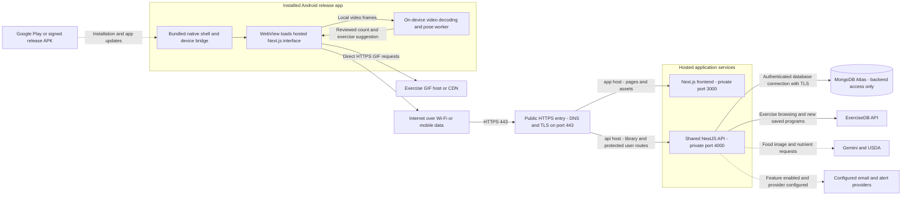

# Network layout: deployed Android app

Updated October 18, 2026 for the shared API. This is a deployment design, not evidence of a live Render deployment. The current Blueprint declares two application services: web and API.

[PNG diagram](diagrams/NETWORK-layout.png) · [SVG diagram](diagrams/NETWORK-layout.svg) · [Editable draw.io diagram](diagrams/PhysiqueQuest-Network.drawio) · [Editable Mermaid source](NETWORK_LAYOUT.mmd)

## How the connections work

1. A signed Android application contains the native shell and device bridge. Its WebView loads the hosted Next.js pages, JavaScript, pose model and WASM over HTTPS. Expo Go and Metro are development tools and are not needed by the installed release app.
2. The WebView sends exercise-library and account/workout requests to one public API origin. Public exercise guides do not require login; private user requests carry a JWT. The backend enforces ownership and administrator roles.
3. The shared NestJS API connects to MongoDB Atlas for application data, including saved programs and daily sessions. Only the backend holds database credentials. There are 15 active application collections; the phone never connects to MongoDB directly.
4. The same API process requests ExerciseDB for browsing and new saved-program generation. Both paths share the provider's in-flight deduplication and pacing. An existing matching saved program avoids fresh generation. External provider failures stay visible with retry.
5. GIF URLs returned by the catalog are loaded directly by the WebView from their media host. RepDB's display module is lazy-loaded from the web app; its still illustrations load from the pinned publisher URLs when details are opened. Neither source is a new database or separate project service.
6. Video decoding, pose inference, exercise suggestions and rep counting run on the user's device. Only reviewed workout results are saved. This layout adds no remote pose-analysis service.
7. Food photos and nutrient lookups go through the API to configured Gemini/USDA services. Recovery-email and foreground safety-alert delivery use configured providers. Credentials stay on the server. Safety monitoring is paused while the Android app is backgrounded/locked and requires an explicit resume.

## Hosts and ports

| Connection | Example address | Purpose |
|---|---|---|
| Android → web | `https://app.physiquequest.example` | Hosted interface, JS, pose assets and lazy catalog chunk. |
| Android → shared API | `https://api.physiquequest.example/api` | Public guides plus protected accounts, workouts and saved plans. |
| Shared API → Atlas | Server-side `MONGODB_URI` | Database connection with TLS/network controls. |
| Shared API → ExerciseDB | Provider HTTPS endpoint | Metadata, instructions and GIF URLs. |
| Android → media hosts | Returned HTTPS URLs | Direct exercise GIFs and guide illustrations. |

The example hosts are placeholders, not provisioned domains. Public entry uses DNS/TLS on port 443. Example private app ports are 3000 for Next.js and 4000 for the shared API; Render assigns the actual process port through `PORT`. The hosting firewall/proxy should expose public HTTPS endpoints, not development listeners. There is no separate library hostname or port-4050 process.

## Configuration and availability

Set `NEXT_PUBLIC_API_URL` at web build time to the shared public API URL including `/api`. Set `EXPO_PUBLIC_WEB_APP_URL` and `EXPO_PUBLIC_API_URL` for the signed Android build, using public HTTPS addresses. Configure `FRONTEND_URL` for the API's allowed web origin. Retired Coach-specific URL variables are no longer read. See [Render deployment](RENDER_DEPLOYMENT.md) for current configuration.

The library now shares the main API's uptime and database-dependent startup. Combining processes reduces separate runtime/deployment overhead, but does not make upstream services faster or guarantee availability. Free Render services can sleep and add cold-start delay. Measure physical Android behavior and hosted traffic before selecting production capacity. No RAM/latency savings percentage has been measured.

Use the [LAN layout](NETWORK_LAYOUT_LAN.md) when testing through Expo Go. Migration details and local startup commands are in [the combined API report](COMBINED_API.md).
