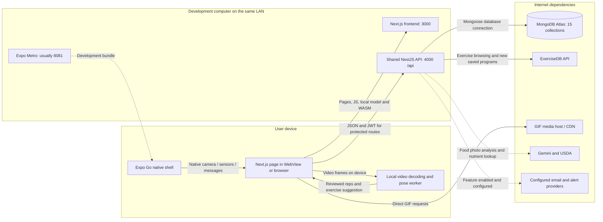

# Network layout: LAN development

Updated October 18, 2026. The library and saved Coach programs share the main backend; no independent catalog listener is required.

[PNG diagram](diagrams/NETWORK-layout-LAN.png) · [SVG diagram](diagrams/NETWORK-layout-LAN.svg) · [Editable draw.io diagram](diagrams/PhysiqueQuest-Network-LAN.drawio) · [Editable Mermaid source](NETWORK_LAYOUT_LAN.mmd)



## Components and connections

| Component | Location | Connection |
|---|---|---|
| Expo Go shell | Android phone | Gets development JS from Metro and opens the Next.js WebView. |
| Next.js frontend | Development computer | TCP 3000; pages, JS, local model/WASM and lazy RepDB chunk. |
| Shared NestJS API | Development computer | TCP 4000 `/api`; public library and private user/admin routes. |
| Expo Metro | Development computer | Usually TCP 8081; development bundle only. |
| MongoDB Atlas | Cloud | Backend-only database connection; 15 application collections. |
| ExerciseDB | External provider | Shared API reads exercise metadata and supplies GIF URLs. |
| Media hosts | External providers | WebView/browser reads GIFs and pinned RepDB illustrations directly. |
| Food/email/alert providers | External providers | Backend-only requests when configured and invoked. |

The phone and computer must share a reachable LAN. For example, `http://192.168.1.10:3000` supplies the frontend and `http://192.168.1.10:4000/api` supplies both library and account requests. The router is a network path, not an API proxy. Allow the needed application/Metro ports through the computer's private-network firewall. No extra port 4050 is required. An Expo tunnel carries the development bundle; it does not expose the frontend/API ports automatically.

The library routes return public ExerciseDB/PhysiqueQuest guides. Saved programs, workout results and account details require a JWT; admin exercise management also requires an admin role. The shared provider handles both browsing and new-program generation in one process. Existing matching program versions reuse MongoDB snapshots. A backend/database startup failure now affects provider-library availability too.

Uploaded video decoding and pose inference stay on the device. The camera/native bridge supplies local frames and sensors; reviewed results are saved through the API. No remote pose provider is part of this network path. Foreground safety monitoring pauses while locked/backgrounded and must be resumed explicitly.

## Start the system

From the project root in separate terminals:

```powershell
npm --prefix backend run start:dev
```

```powershell
npm run dev
```

```powershell
npm run expo
```

For a faster production frontend preview, replace the second command with `npm run build`, then `npm run start -- --hostname 0.0.0.0`. Keep MongoDB/JWT/provider credentials in backend environment files. Clients use the shared API URL; Coach-specific address overrides are retired.

This layout describes development. Use the [deployed Android layout](NETWORK_LAYOUT.md) for public HTTPS hosting and a signed APK.
